# Examples

The repository has two kinds of examples:

- **[Python examples](#python-examples)** in the
  [`examples`](https://github.com/freand76/digsim/tree/main/examples) folder build and
  simulate circuits in code. Most of them write a VCD file with all signals.
- **[GUI example circuits](#gui-example-circuits)** in the
  [`example_circuits`](https://github.com/freand76/digsim/tree/main/example_circuits) folder
  are ready-made circuits to open in the DigSim application.

To run them, clone the repository and run the commands below from its root folder (see
[Run from source](installation.md#run-from-source)):

```sh
git clone https://github.com/freand76/digsim.git
cd digsim
```

The waveform images on this page are rendered from the VCD files that the examples write.
To look at the waveforms yourself, open the VCD file in
[GTKWave](https://gtkwave.sourceforge.net/) or another VCD viewer, for example
`gtkwave sr.vcd`.

## Python examples

### SR latch

[`examples/example_sr.py`](https://github.com/freand76/digsim/blob/main/examples/example_sr.py)
connects two push buttons to the set and reset inputs of an SR latch (built from two NOR
gates) and the latch output to an LED. The script presses the buttons in a fixed sequence,
and a callback prints the LED state every time it changes.

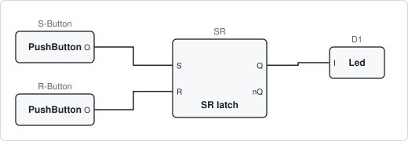

```sh
uv run python examples/example_sr.py
```

The left column is the simulation time in nanoseconds. Pressing *set* a second time does
not change the output, the latch is already set:

```text
        0:LED: 'D1' is OFF
Reset
 10000001:LED: 'D1' is OFF
Set
 30000002:LED: 'D1' is ON
Set (again)
Reset
 60000001:LED: 'D1' is OFF
```

The waveforms are written to `sr.vcd`. The latch output is unknown (red) until the first
reset:

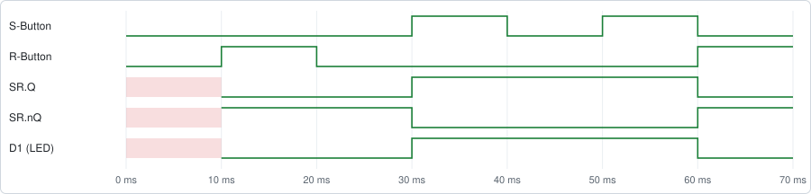

### Clock

[`examples/example_clock.py`](https://github.com/freand76/digsim/blob/main/examples/example_clock.py)
connects a 20 Hz clock to an LED and simulates one second.

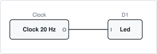

```sh
uv run python examples/example_clock.py
```

The LED toggles every 25 ms (half a 20 Hz period):

```text
        0:LED: 'D1' is OFF
        0:LED: 'D1' is OFF
 25000000:LED: 'D1' is ON
 50000000:LED: 'D1' is OFF
 75000000:LED: 'D1' is ON
...
975000000:LED: 'D1' is ON
1000000000:LED: 'D1' is OFF
```

The first 300 ms of `clock.vcd`:

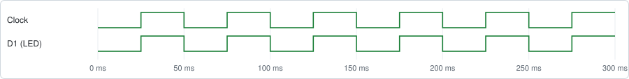

### Save a circuit (pulse generator)

[`examples/load_save/example_save_circuit.py`](https://github.com/freand76/digsim/blob/main/examples/load_save/example_save_circuit.py)
builds a pulse generator: a push button drives one AND input directly and the other through
three NOT gates. The circuit is simulated, saved to `pulse_circuit.json`, loaded into a new
circuit and simulated again.

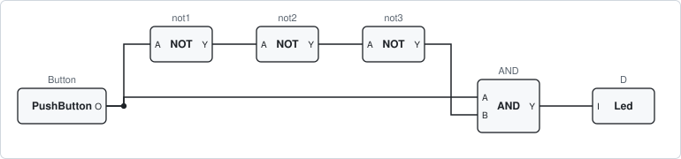

```sh
uv run python examples/load_save/example_save_circuit.py
```

When the button is pressed, both AND inputs are high for a moment, until the change has
propagated through the three NOT gates (1 ns each). The LED is on for 3 ns. The second
half of the output comes from the loaded copy of the circuit:

```text
        0:LED: 'D' is OFF
        1:LED: 'D' is OFF
ON
 10000001:LED: 'D' is ON
 10000004:LED: 'D' is OFF
OFF
        1:LED: 'D' is OFF
  5000001:LED: 'D' is ON
  5000004:LED: 'D' is OFF
```

The waveforms in `pulse.vcd`, zoomed in on the button press at 10 ms, show the change
moving through the gates:

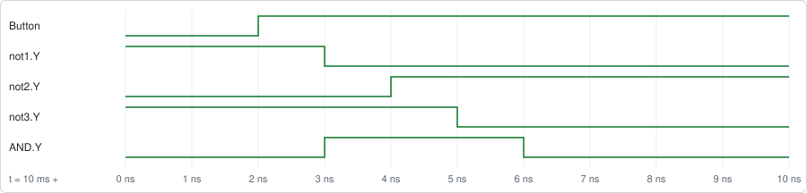

### Load a circuit (logic gates)

[`examples/load_save/example_load_circuit.py`](https://github.com/freand76/digsim/blob/main/examples/load_save/example_load_circuit.py)
loads the circuit in
[`example_circuit.json`](https://github.com/freand76/digsim/blob/main/examples/load_save/example_circuit.json):
two buttons connected to an AND, a NOT and an XOR gate, each driving an LED. The script
presses the buttons in a sequence and prints the LED changes.

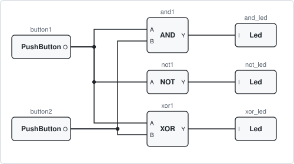

```sh
uv run python examples/load_save/example_load_circuit.py
```

The `------------` lines show the button states (button1 button2) for the next step:

```text
        1:LED: 'and_led' is OFF
        1:LED: 'xor_led' is OFF
        1:LED: 'not_led' is ON
------------ 10
  5000001:LED: 'not_led' is OFF
  5000001:LED: 'xor_led' is ON
------------ 00
 10000001:LED: 'not_led' is ON
 10000001:LED: 'xor_led' is OFF
------------ 10
 15000001:LED: 'not_led' is OFF
 15000001:LED: 'xor_led' is ON
------------ 11
 20000001:LED: 'and_led' is ON
 20000001:LED: 'xor_led' is OFF
```

The waveforms in `circuit.vcd`:

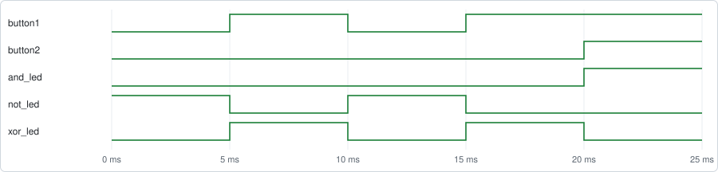

### Verilog counter

The two examples in
[`examples/yosys_counter`](https://github.com/freand76/digsim/tree/main/examples/yosys_counter)
simulate the 4-bit counter in
[`counter.v`](https://github.com/freand76/digsim/blob/main/examples/yosys_counter/counter.v):

- `example_yosys_counter_netlist.py` loads the pre-synthesized netlist `counter.json`.
- `example_yosys_counter_verilog.py` loads `counter.v` and synthesizes it on the fly.

Both connect push buttons to the clock and reset inputs and tie the `up` input high,
reset the counter and then clock it 16 times.

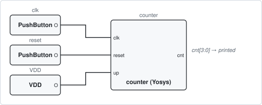

```sh
uv run python examples/yosys_counter/example_yosys_counter_netlist.py
uv run python examples/yosys_counter/example_yosys_counter_verilog.py
```

Both print the same output, the counter value before each clock pulse:

```text
===================== Reset ==========================

counter
 - I:clk=0
 - I:reset=0
 - I:up=1
 - O:cnt=0

===================== Start ==========================

OUT 0
OUT 1
OUT 2
...
OUT 14
OUT 15
```

`counter.vcd` is started after the reset:

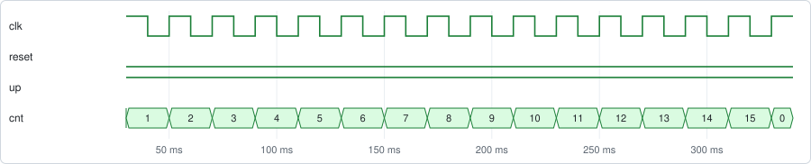

### Synthesis (Fibonacci sequence)

[`examples/synthesis/example_synthesis.py`](https://github.com/freand76/digsim/blob/main/examples/synthesis/example_synthesis.py)
synthesizes [`fibonacci.v`](https://github.com/freand76/digsim/blob/main/examples/synthesis/fibonacci.v),
a Fibonacci sequence generator, with Yosys from Python, loads the netlist as a component and
drives its clock and reset inputs directly from the script.

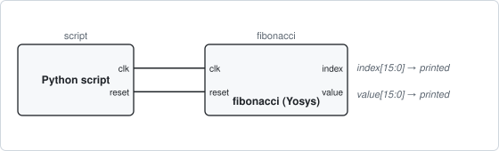

```sh
uv run python examples/synthesis/example_synthesis.py
```

```text
Start synthesis of 'examples/synthesis/fibonacci.v'
Synthesis done!
...
Fibonacci sequence [0] value is 0
Fibonacci sequence [1] value is 1
Fibonacci sequence [2] value is 1
Fibonacci sequence [3] value is 2
Fibonacci sequence [4] value is 3
Fibonacci sequence [5] value is 5
...
Fibonacci sequence [14] value is 377
Fibonacci sequence [15] value is 610
```

The netlist is written to `examples/synthesis/fibonacci.json` and the waveforms to
`fibonacci.vcd`:

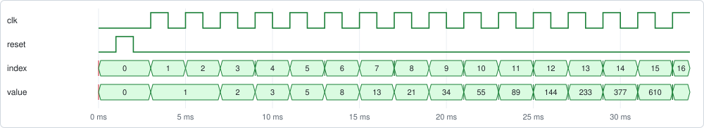

### 6502 CPU

[`examples/yosys_6502/example_yosys_6502.py`](https://github.com/freand76/digsim/blob/main/examples/yosys_6502/example_yosys_6502.py)
simulates a synthesized [6502 CPU](https://en.wikipedia.org/wiki/MOS_Technology_6502)
(`6502_primitives.json`) connected to a 64 kB memory and a memory-mapped text output at address
`0x8000`. The program in the memory, built from
[`code.s`](https://github.com/freand76/digsim/blob/main/examples/yosys_6502/code.s),
writes "Hello World" to the text output, which prints each character.

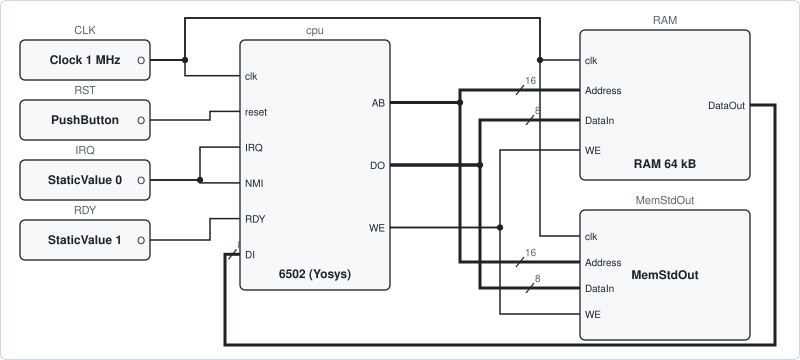

```sh
uv run python examples/yosys_6502/example_yosys_6502.py
```

The simulation of 300 clock cycles takes less than a second, and the example prints how
many clock cycles it simulated per second:

```text
cpu
 - I:clk=0
 - I:reset=0
 - I:DI=X
 - I:IRQ=0
 - I:NMI=0
 - I:RDY=1
 - O:AB=X
 - O:DO=X
 - O:WE=X
StringOutput [char]: 'H'
StringOutput [char]: 'e'
StringOutput [char]: 'l'
StringOutput [char]: 'l'
StringOutput [char]: 'o'
StringOutput [char]: ' '
StringOutput [char]: 'W'
StringOutput [char]: 'o'
StringOutput [char]: 'r'
StringOutput [char]: 'l'
StringOutput [char]: 'd'
StringOutput [line]: 'Hello World'
Simulated 302 clock cycles of 6502_primitives.json in 0.41 s: 728 clocks/second
```

`6502_primitives.json` is the CPU synthesized into gates. Add `--functional` to run
`6502_functional.json` instead, the same CPU synthesized into functional blocks like
adders and multiplexers (see
[Gates or functional blocks](synthesis.md#gates-or-functional-blocks)):

```sh
uv run python examples/yosys_6502/example_yosys_6502.py --functional
```

```text
...
StringOutput [line]: 'Hello World'
Simulated 302 clock cycles of 6502_functional.json in 0.26 s: 1147 clocks/second
```

`verilog/synth.sh` in the repository synthesizes both netlists.

Add `--signals` to make the internal signals of the CPU readable (see
[Internal signals and states](synthesis.md#internal-signals-and-states)). The example then
prints the registers after the simulation, and with `--vcd` the waveforms have the
signals inside the CPU too, with the state of the CPU as the names of its states:

```sh
uv run python examples/yosys_6502/example_yosys_6502.py --functional --signals
```

```text
...
CPU: PC=F82E A=00 X=00 Y=0C S=FF P=37 state=DECODE
```

Waveforms are not written by default, since writing every signal in the CPU makes the
simulation slower. Add `--vcd` to write them to `6502.vcd`, or `--vcd <file>` to choose the
file name:

```sh
uv run python examples/yosys_6502/example_yosys_6502.py --vcd
```

The waveforms below (values in hex) show the CPU fetching the program from `F823` and
onwards, then writing `48`, the character `H`, to the text output at address `8000`:

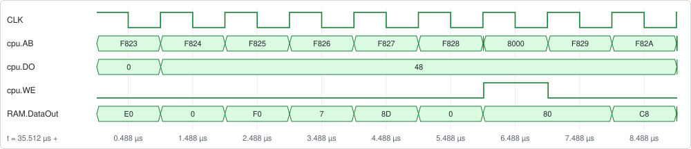

To change the program, edit the assembly files and rebuild `code.bin` with `compile.sh`,
which needs the [cc65](https://cc65.github.io/) assembler and linker.

### State machine (traffic light)

[`examples/yosys_fsm/example_yosys_fsm.py`](https://github.com/freand76/digsim/blob/main/examples/yosys_fsm/example_yosys_fsm.py)
simulates a traffic light, a state machine in
[`traffic_light.sv`](https://github.com/freand76/digsim/blob/main/examples/yosys_fsm/traffic_light.sv)
with its states as a SystemVerilog enum. A request turns the light from red to green, and
back after a while. The component is created with `signals=True`, so its internal signals,
the state and a timer, are readable, and the state has the names of the enum:

```python
light = YosysComponent(circuit, path="traffic_light.sv", functional=True, signals=True)
light.state("state")  # "RED", "RED_YELLOW", "GREEN" or "YELLOW"
```

```sh
uv run python examples/yosys_fsm/example_yosys_fsm.py
```

```text
Internal signals: state, timer
   10 ms: RED
  200 ms: RED after the reset
  260 ms: RED_YELLOW
  460 ms: GREEN
  960 ms: YELLOW
 1160 ms: RED
```

The example writes `traffic_light.vcd`, with the state as text, the name of the state:

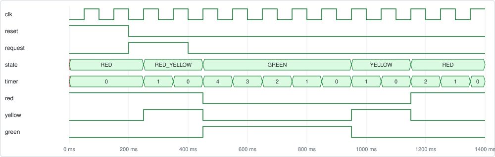

In the VCD file the state is a string variable:

```text
$var string 1 0! state $end
...
#250000001
sRED_YELLOW 0!
...
#450000001
sGREEN 0!
```

### pytest testbenches

[`examples/pytest_tb`](https://github.com/freand76/digsim/tree/main/examples/pytest_tb) tests
two Verilog designs with [pytest](https://pytest.org/): an 8-bit ALU (`alu.v`) and a 4-bit
up/down counter (`up_down_counter.v`). Each test module synthesizes its design in a fixture,
drives the inputs from Python and asserts on the outputs. See
[Verilog Testbench with pytest](testbenches.md) for how they work.

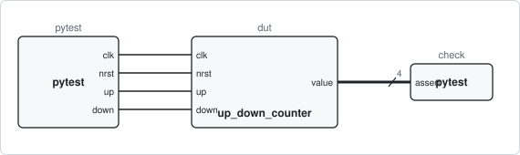

```sh
uv run --with pytest pytest -v examples/pytest_tb
```

```text
examples/pytest_tb/test_alu_testbench.py::test_add PASSED
examples/pytest_tb/test_alu_testbench.py::test_sub PASSED
examples/pytest_tb/test_alu_testbench.py::test_and PASSED
examples/pytest_tb/test_alu_testbench.py::test_or PASSED
examples/pytest_tb/test_alu_testbench.py::test_xor PASSED
examples/pytest_tb/test_alu_testbench.py::test_logic_lshift PASSED
examples/pytest_tb/test_alu_testbench.py::test_logic_rshift PASSED
examples/pytest_tb/test_alu_testbench.py::test_arith_rshift PASSED
examples/pytest_tb/test_up_down_counter_testbench.py::test_no_count PASSED
examples/pytest_tb/test_up_down_counter_testbench.py::test_count_up PASSED
examples/pytest_tb/test_up_down_counter_testbench.py::test_count_down PASSED
examples/pytest_tb/test_up_down_counter_testbench.py::test_up_precedence PASSED
examples/pytest_tb/test_up_down_counter_testbench.py::test_reset_after_count PASSED
```

The tests write `alu_test.vcd` and `up_down_counter_test.vcd`. The counter tests, one after
the other: no counting, counting up to 15 and wrapping to 0, counting down, and resets:

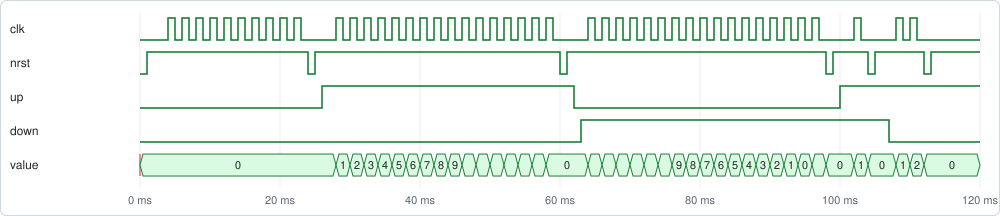

## GUI example circuits

Open a circuit in the application with `--load`, then press **Start Simulation** (or
**Space**):

```sh
uv run -m digsim.app --load example_circuits/counter_yosys_netlist.circuit
```

You can also use **Load Circuit** in the application. See [GUI Reference](gui.md) for how
to work with the editor.

### Verilog counter

`counter_yosys_netlist.circuit` and `counter_yosys_verilog.circuit` are the same circuit:
the [Verilog counter](#verilog-counter) as a Yosys component, loaded from the netlist or
directly from `counter.v`. Notes in the circuit explain each part:

- a 5 Hz clock drives the counter and an LED,
- a push button resets the counter (shortcut **1**),
- a switch enables counting (shortcut **2**),
- a hex digit shows the counter value,
- a logic analyzer shows the clock, button, switch and the four counter bits, connected
  through Wire Sources/Sinks and a bus splitter,
- a buzzer sounds while the reset button is pressed.

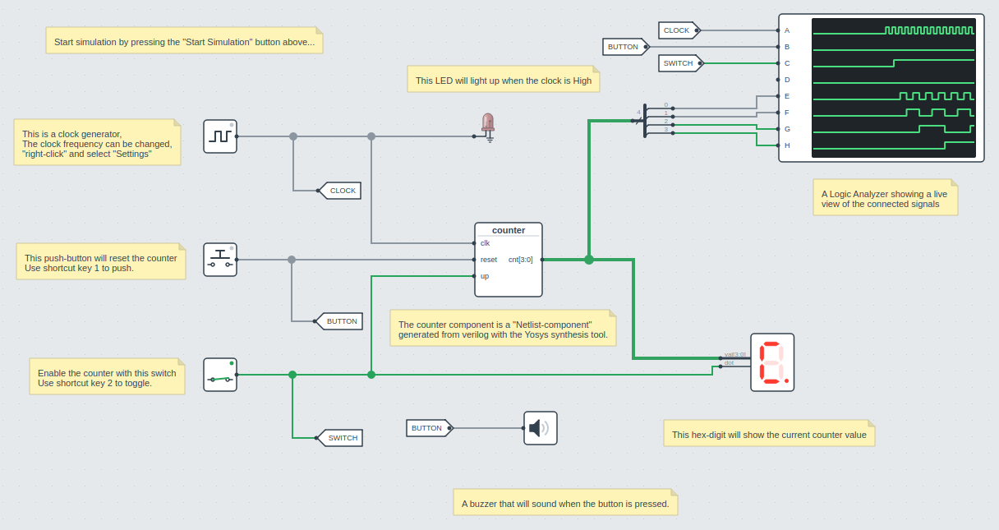

Turn on the switch to start counting.

### 74162 counter

`74162_counter.circuit` rebuilds a classic counter board with two ICs from the built-in IC
library: a 74162 synchronous decade counter and a 7448 BCD to 7-segment decoder.

- A 5 Hz clock drives the counter, and the switch enables counting (`ENP` and `ENT`).
- The 7448 decodes the counter value to the 7-segment display.
- The LED shows the counter's ripple-carry output (`RCO`), which is high on the count of 9.
- The DIP switch sets a value that is loaded with one push button (`Load`), and another push
  button clears the counter (`Clear`). Both inputs are active low, hence the NOT gates.
- The third push button drives the 7448 lamp-test input (`lt`).

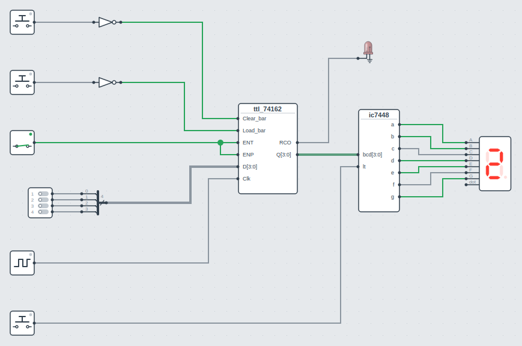

### Shift register

`shift_register.circuit` is a 6-bit shift register: six D flip-flops in a chain, clocked
by a 5 Hz clock, with an LED on each output. Press the push button to shift ones into the
register and watch them move along the LEDs.

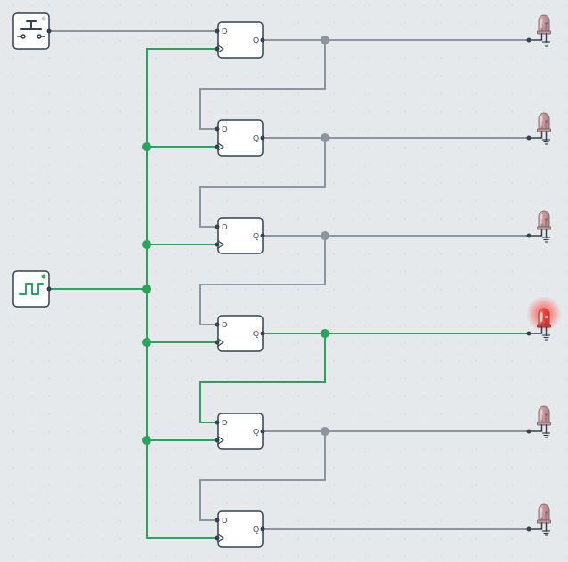

### Buzzers

`buzzers.circuit` has five push buttons, each connected to a buzzer with its own tone
(C, D, E, F and G). Press the buttons, or the shortcut keys **1** to **5**, while the
simulation runs to play a tune.

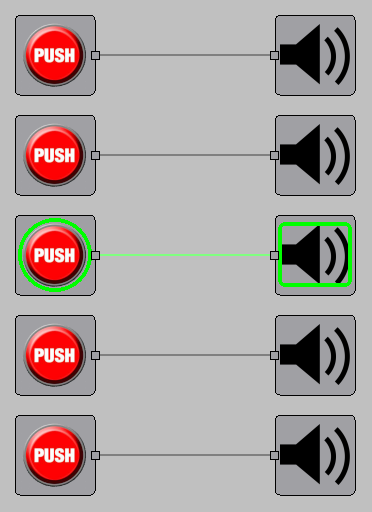

## Regenerating the images

The images on this page are generated by
[`docs/scripts/generate_examples.py`](https://github.com/freand76/digsim/blob/main/docs/scripts/generate_examples.py),
which runs the examples, renders the waveforms from their VCD files and takes screenshots
of the GUI circuits:

```sh
uv run --with pytest python docs/scripts/generate_examples.py
```
