# Your First Circuit

This guide walks you through building and simulating a small circuit in the DigSim
application: two switches connected to an AND gate that lights an LED. It takes about ten
minutes, and you will learn the basics that all larger circuits are built with:

- adding components to the circuit,
- connecting them with wires,
- running the simulation and interacting with it,
- saving the circuit.

You need DigSim installed, see [Installation](installation.md). The
[GUI Reference](gui.md) describes everything in the application in more detail.

## 1. Start DigSim

Start the application from a terminal:

```sh
digsim-logic-simulator
```

Or, without installing anything, with `uvx digsim-logic-simulator`.

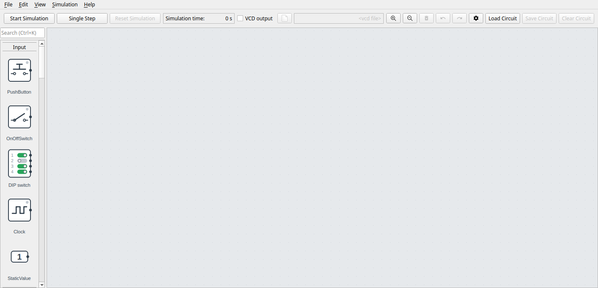

The window has three parts:

- **Component selection** (left): all components, grouped into Input, Output, Gates and
  more. Scroll down to see them all.
- **Circuit area** (the large gray area): where you build the circuit.
- **Control area** (top): starts and stops the simulation. The menu bar above it opens and
  saves circuits.

## 2. Add a switch

Find **OnOffSwitch** in the **Input** group. Drag it into the circuit area and release
the mouse button where you want it. While you drag, a preview shows where the switch
will be placed.

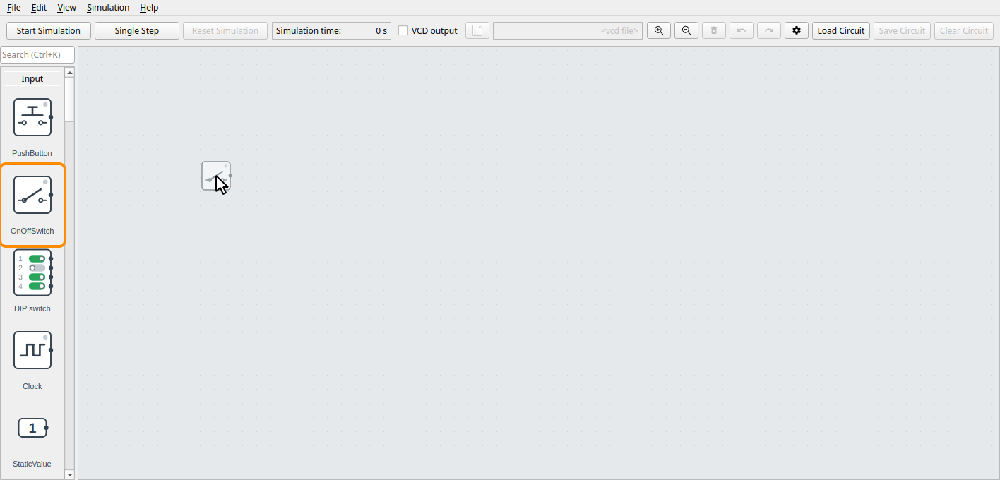

!!! tip
    You can also **double-click** a component in the component selection. It is then
    placed in the upper left part of the circuit area.

## 3. Add a second switch

Add one more switch in the same way, below the first one.

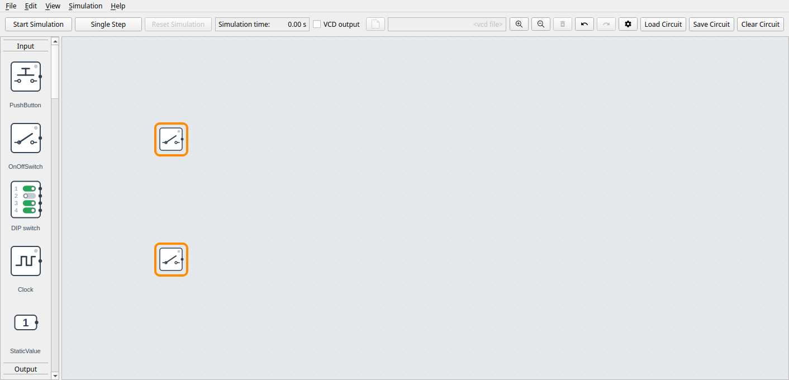

To move a component, drag it with the mouse. To remove one, click it to select it and
press **Del**. If you make a mistake, **Ctrl+Z** undoes it.

## 4. Add an AND gate

Scroll down to the **Gates** group and drag an **AND** gate into the circuit area,
between the switches and the right edge.

The new gate is selected, and its settings are in the settings pane, to the right of the
circuit area. For the AND gate, that is the number of inputs. Keep **2**. To change it,
move the slider and click **Apply**.

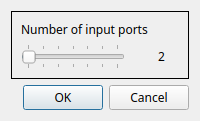

The gate has two inputs on its left side, **A** and **B**, and an output **Y** on its
right side.

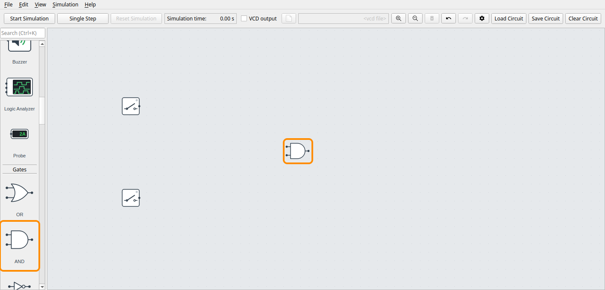

## 5. Add an LED

Drag an **LED** from the **Output** group to the right of the AND gate. It asks for its
color: keep **red** and click **OK**. It has a single input on its left side.

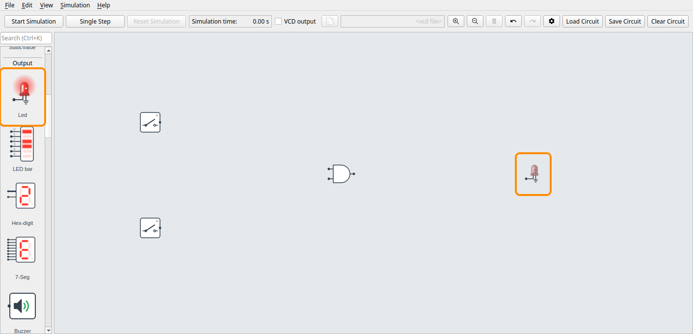

## 6. Connect the wires

Wires connect the small dots on the sides of the components, called **ports**.
Outputs are on the right side of a component and inputs on the left side.

To draw a wire, **click a port**, and then **click the port you want to connect it to**.
Start with the output of the upper switch: click its port. A wire follows the mouse
pointer until you click the other end, input **A** of the AND gate.

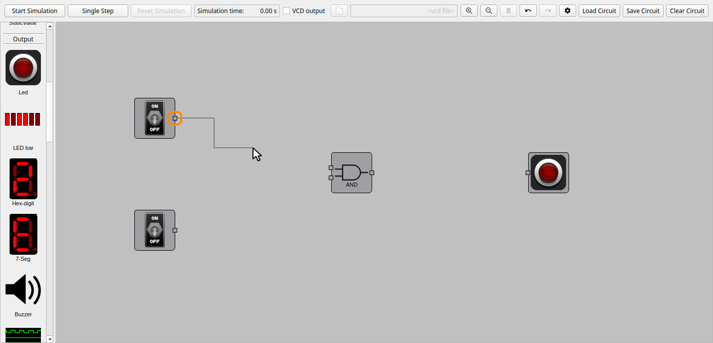

Connect the rest of the circuit in the same way:

- the output of the lower switch to input **B** of the AND gate,
- the output **Y** of the AND gate to the input of the LED.

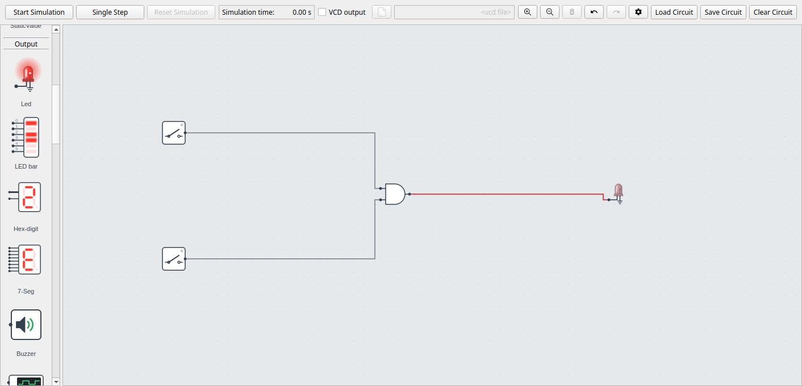

!!! tip
    Press **Esc** to cancel a wire that you have started. One output can drive any
    number of inputs, but each input can only have one wire to it.

## 7. Start the simulation

Click **Start Simulation** in the control area, or press **Space**. The simulation time
starts counting, and the button changes to **Stop Simulation**.

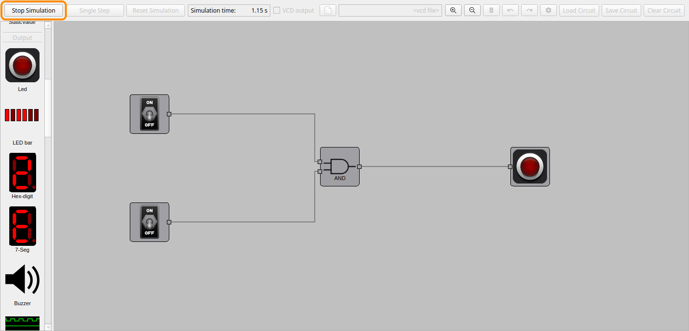

The wires now show the logic level they carry: **dark gray** for 0 and **green** for 1.
A **red** wire has an undefined value, for example from an input that is not connected
to anything. While the simulation runs, the circuit can't be edited.

## 8. Try it out

Click the upper switch to turn it on. Its wire turns green, but the LED stays off: an AND
gate only outputs 1 when **both** its inputs are 1.

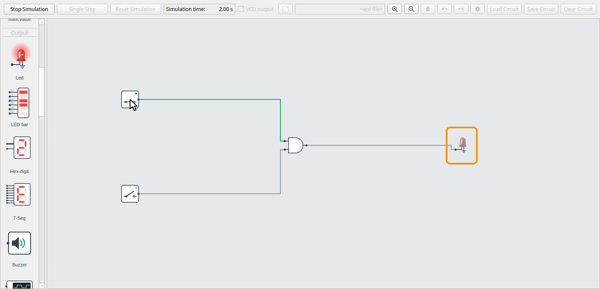

Now click the lower switch. Both inputs of the AND gate are 1, and the LED lights up.

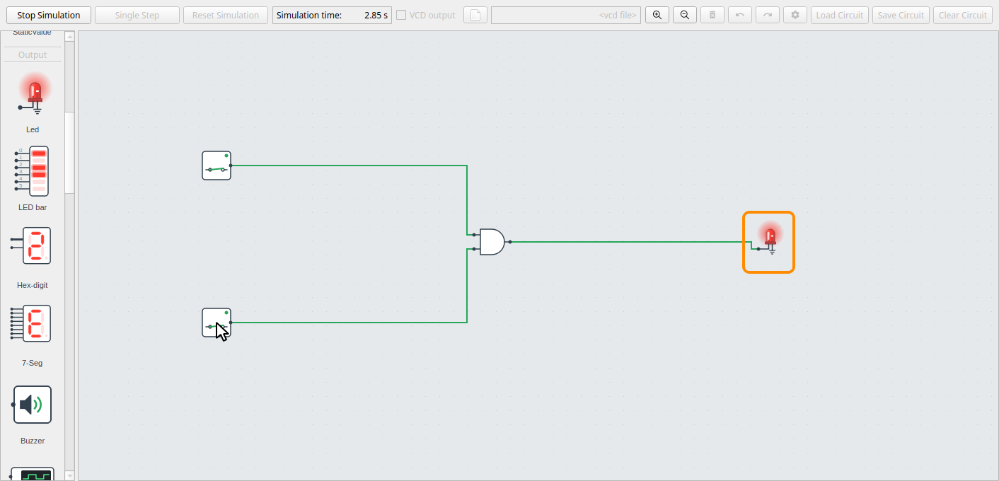

Click the switches a few times and check that the LED follows the truth table of an AND
gate:

| Upper switch | Lower switch | LED |
| --- | --- | --- |
| Off | Off | Off |
| On | Off | Off |
| Off | On | Off |
| On | On | **On** |

## 9. Stop and save the circuit

Click **Stop Simulation** (or press **Space**). Then choose **File > Save** (**Ctrl + S**)
and a file name, for example `first_circuit.circuit`.

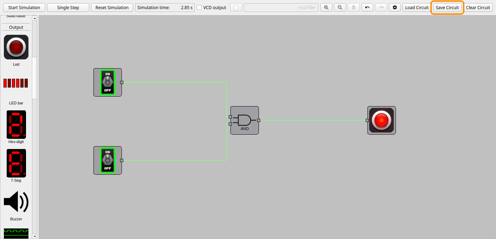

To open the circuit again later, choose **File > Open** (**Ctrl + O**), or start DigSim
with the file:

```sh
digsim-logic-simulator --load first_circuit.circuit
```

## Next steps

Now that you know the basics, here are some things to try:

- **Other gates:** delete the AND gate (click it and press **Del**), add an OR or XOR gate
  instead, connect it, and compare their truth tables.
- **Keyboard shortcuts:** right-click a switch and choose **Shortcut** to toggle it with a
  number key while the simulation runs.
- **Waveforms:** check **VCD output** before you start the simulation, to record all
  signals to a file that you can view in [GTKWave](https://gtkwave.sourceforge.net/).
- **More components:** clocks, flip-flops, hex displays and more are described in the
  [GUI Reference](gui.md#component-reference).
- **Example circuits:** load the circuits in the
  [`example_circuits`](https://github.com/freand76/digsim/tree/main/example_circuits)
  folder, described in [Examples](examples.md#gui-example-circuits).
- **Your own Verilog:** write a component in Verilog, see
  [Your First Verilog Component](new-verilog.md), and change one in the editor, see
  [Editing a Verilog Component](verilog-tutorial.md).
