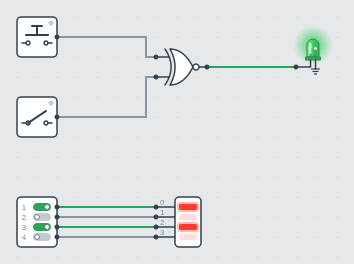
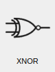
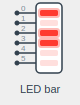

# Adding Components to the GUI

This guide adds the `XNOR` gate and the `LedBar` from [Creating Components](components.md)
to the DigSim application. The XNOR gate is drawn as a gate symbol, like the other gates,
and the LED bar is drawn by code, so it can show its current value.



The finished code is in DigSim: the GUI objects are in
[`_symbol_objects.py`](https://github.com/freand76/digsim/blob/main/src/digsim/app/gui_objects/_symbol_objects.py)
and
[`_led_bar_object.py`](https://github.com/freand76/digsim/blob/main/src/digsim/app/gui_objects/_led_bar_object.py).
Contributions of new components are welcome, see [Contributing](contributing.md).

The GUI can only show components that are part of DigSim, so this changes DigSim's source
code. Start with a [development setup](contributing.md#development-setup). These are
all the steps needed to get a component into the component selector:

1. [Add the component to DigSim](#1-add-the-component-to-digsim)
2. [Export it from `digsim.circuit.components`](#2-export-the-component)
3. Create a GUI object, either [a gate symbol](#3a-a-gate-symbol) or
   [drawn by code](#3b-a-gui-object-drawn-by-code)
4. [Register the GUI object](#4-register-the-gui-object)
5. [Add the component to the component selector](#5-add-it-to-the-component-selector)
6. [Check the settings pane](#6-the-settings-pane)
7. [Try it](#7-try-it)

## 1. Add the component to DigSim

Move the component class to its own module in
[`src/digsim/circuit/components`](https://github.com/freand76/digsim/tree/main/src/digsim/circuit/components),
for example `_xnor.py` and `_led_bar.py`. Module names start with `_`, and the code in
DigSim is type annotated, so the class looks like this:

```python
# src/digsim/circuit/components/_xnor.py
from __future__ import annotations

from typing import TYPE_CHECKING

from .atoms import Component, PortIn, PortOutDelta


if TYPE_CHECKING:
    from digsim.circuit import Circuit


class XNOR(Component):
    """XNOR logic gate: Y is high when A and B are equal"""

    def __init__(self, circuit: Circuit, name: str | None = None) -> None:
        super().__init__(circuit, name)
        ...

    def update(self) -> None: ...
```

## 2. Export the component

Add the class to
[`src/digsim/circuit/components/__init__.py`](https://github.com/freand76/digsim/blob/main/src/digsim/circuit/components/__init__.py):

```python
from ._led_bar import LedBar
from ._xnor import XNOR
```

Both the GUI and saved circuit files find components by their name in
`digsim.circuit.components`. A saved XNOR gate is stored as
`digsim.circuit.components.XNOR`.

## 3a. A gate symbol

Each component in the GUI is shown by a *GUI object*, a class in
[`src/digsim/app/gui_objects`](https://github.com/freand76/digsim/tree/main/src/digsim/app/gui_objects).
Gates subclass `GateObject`, which draws the symbol of a gate from its shape (`"and"`,
`"or"` or `"buffer"`), with a bubble on an inverted output and the second curve of an
exclusive gate, and a lead to each port. It also draws the icon in the component selector.
In
[`_symbol_objects.py`](https://github.com/freand76/digsim/blob/main/src/digsim/app/gui_objects/_symbol_objects.py):

```python
class XnorObject(GateObject):
    """An XNOR gate in the GUI"""

    SHAPE = "or"
    EXCLUSIVE = True
    INVERT = True
```

!!! tip "A component with many ports"
    Components with many ports, like ICs, subclass `NamedBoxObject`: a body with the
    component's name in a header and the names of the ports.

## 3b. A GUI object drawn by code

To show the state of a component, draw it in `paint_component()`. Subclass
`ComponentObject`, in a new module such as `_led_bar_object.py`. Use the colors, lines
and fonts of `_theme.py`, like `theme.INK`, `theme.lead()` and `theme.paint_text()`, so
that it looks like the other components:

```python
from __future__ import annotations

from typing import TYPE_CHECKING

from PySide6.QtCore import QPointF, QRectF, QSize, Qt
from PySide6.QtGui import QPainter

from digsim.circuit.components import LedBar
from digsim.circuit.components.atoms import Component

from . import _theme as theme
from ._component_object import ComponentObject
from ._symbol_objects import paint_icon, port_dots


if TYPE_CHECKING:
    from digsim.app.model import AppModel


class LedBarObject(ComponentObject):
    """
    A LED bar: the display without a body, LED 0 at the top, and a numbered lead from
    each input to its LED
    """

    SHOW_PORT_NAMES = False
    LED_WIDTH = 18
    LED_HEIGHT = 6
    # From one LED to the next, and from one input to the next
    LED_DISTANCE = 10
    # From the display to the LEDs, at the sides
    MARGIN = 4
    # From the inputs to the display, room for the numbers
    LEAD = 18

    def __init__(
        self, app_model: AppModel, component: Component, xpos: float, ypos: float
    ) -> None:
        super().__init__(app_model, component, xpos, ypos, port_distance=self.LED_DISTANCE)
        self.update_size()

    @property
    def component(self) -> LedBar:
        component = self._component
        assert isinstance(component, LedBar)
        return component

    def update_size(self) -> None:
        leds = len(self.component.lit())
        self.width = self.LEAD + self.LED_WIDTH + 2 * self.MARGIN
        self.height = (leds - 1) * self.LED_DISTANCE + 2 * self.BORDER_TO_PORT
        self.update_ports()

    @classmethod
    def paint_bar(
        cls,
        painter: QPainter,
        rect: QRectF,
        ys: list[float],
        lit: list[bool],
        color: str,
        selected: bool,
    ) -> None:
        """The numbered leads, the display and an LED at each y"""
        display = rect.adjusted(cls.LEAD, 0, 0, 0)
        for number, y in enumerate(ys):
            theme.lead(painter, QPointF(rect.left() - 1, y), QPointF(display.left(), y))
            theme.paint_text(
                painter,
                QRectF(rect.left() + 3, y - 9, cls.LEAD - 5, 8),
                str(number),
                6,
                theme.MUTED,
                Qt.AlignmentFlag.AlignLeft,
            )
        painter.setRenderHint(QPainter.RenderHint.Antialiasing)
        painter.setPen(theme.outline_pen(True) if selected else Qt.PenStyle.NoPen)
        painter.setBrush(theme.DISPLAY)
        painter.drawRoundedRect(display, theme.CORNER, theme.CORNER)
        for y, on in zip(ys, lit, strict=True):
            led = QRectF(0, 0, cls.LED_WIDTH, cls.LED_HEIGHT)
            led.moveCenter(QPointF(display.center().x(), y))
            theme.paint_bar_led(painter, led, theme.led_color(color), on)

    def paint_component(self, painter: QPainter) -> None:
        ys = [self.get_port_item(port).rect().center().y() for port in self.component.inports()]
        self.paint_bar(
            painter,
            QRectF(self.rect()),
            ys,
            self.component.lit(),
            self.component.color,
            self.selected,
        )

    @classmethod
    def paint_selectable_component(cls, painter: QPainter, size: QSize, name: str) -> None:
        leds = [True, False, True, True, False, False]
        height = (len(leds) - 1) * cls.LED_DISTANCE + 2 * cls.BORDER_TO_PORT

        def paint(rect: QRectF) -> None:
            ys = [rect.top() + cls.BORDER_TO_PORT + cls.LED_DISTANCE * idx for idx in range(6)]
            cls.paint_bar(painter, rect, ys, leds, "red", False)
            port_dots(painter, [QPointF(rect.left() - 1, y) for y in ys])

        width = cls.LEAD + cls.LED_WIDTH + 2 * cls.MARGIN
        paint_icon(painter, size, (width, height), paint, scale=1.0)
        cls.paint_selectable_component_name(painter, QPointF(0, 0), size, name)
```

Each LED is next to its input: `port_distance` sets the distance from one port to the
next, and `BORDER_TO_PORT` the distance from the top of the component to the first port
(10 pixels). The LED bar has no body: its display is the component, and a numbered lead
goes from each input to it. `SHOW_PORT_NAMES = False` leaves out the port names, which
`paint_bar()` draws on the leads instead.

| Method | Purpose |
| --- | --- |
| `paint_component(painter)` | Draws the placed component with a `QPainter`. `paint_component_base()` draws the white body of a device, or a body in the color it is given, `paint_component_name()` the name. The box is `self.rect()`, positioned at `self.object_pos`. |
| `paint_selectable_component(painter, size, name)` | A class method that draws the component's icon in the component selector, in a `size` sized area. |
| `update_size()` | Called when the component's settings change. Set `self.width` and `self.height`, then call `update_ports()` to move the ports. |
| `component` | Override it to return the component's own type, so type checkers know its methods. |

`paint_component()` and `paint_selectable_component()` are abstract methods. If a GUI
object class misses one of them, mypy reports it when the class is registered in
[step 4](#4-register-the-gui-object). Python itself doesn't check it while the application
runs, so run mypy (see [Contributing](contributing.md#before-you-submit)).

The GUI repaints a `CallbackComponent` after its `update()` runs, which is why `LedBar`
subclasses it. A plain `Component` is only repainted when something else in the circuit
changes.

!!! note
    Qt drawing functions that take whole pixels, such as `drawRect(x, y, w, h)`, need
    `int` values, so use `int()` around calculated positions.

## 4. Register the GUI object

Map the component's class name to its GUI object in `CLASS_NAME_TO_COMPONENT_OBJECT` in
[`_gui_object_factory.py`](https://github.com/freand76/digsim/blob/main/src/digsim/app/gui_objects/_gui_object_factory.py),
and import the GUI object class there:

```python
CLASS_NAME_TO_COMPONENT_OBJECT: dict[str, type[ComponentObject]] = {
    ...
    "XNOR": XnorObject,
    "LedBar": LedBarObject,
}
```

## 5. Add it to the component selector

Add a `SelectableComponentWidget` for the component in `ComponentSelection` in
[`src/digsim/app/gui/_component_selection.py`](https://github.com/freand76/digsim/blob/main/src/digsim/app/gui/_component_selection.py).
The order of the lines is the order in the selector, under the group headings ("Input",
"Output", "Gates", ...). `display_name` sets the label, which is the class name otherwise:

```python
layout.addWidget(SelectableComponentWidget("XNOR", self, circuit_area))
layout.addWidget(SelectableComponentWidget("LedBar", self, circuit_area, display_name="LED bar"))
```

{ width="80" }
{ width="80" }

## 6. The settings pane

The settings pane of the GUI shows the selected component's parameters from
`get_parameters()`, with one input per parameter and the component's values from
`settings_to_dict()`. A new component gets the defaults, only a `path` (the first
parameter) and an `ic_name` are asked for before it is added. The parameter's `type`
selects the input:

| `type` | Input | Keys |
| --- | --- | --- |
| `int` | Slider | `min`, `max`, `default` |
| `intrange` | Slider over a list of values | `range`, `default_index` |
| `bool` | Checkbox | `default` |
| `str` | Text field | `default`, `single_line` (one line instead of a text box), `invalid_list` (values not allowed) |
| `list` | Drop-down | `items` |
| `width_pow2` | Slider from 0 to 2<sup>width</sup>-1, following a `width` parameter | `default` |
| `width_bool` | One checkbox per bit, following a `width` parameter | `default` |
| `bit_groups` | Text field with the widths of the groups of a bus, like `4, 4` (a list of ints) | `default` |
| `component_name` | Drop-down that selects another component class | `component_list` (class name to description) |
| `ic_name` | The built-in ICs, with a search, asked for before the IC is added | |
| `path` | File dialog before the component is added (it must be the first parameter), a file field with Browse in the pane | `fileinfo` (file filter), `new_verilog` (asks first to open a file or to make a new Verilog file, which is created with a module). Another parameter with `file_types` (like `[".v", ".sv"]`) is only shown for a file of those types |

Every parameter needs a `description`, the label shown in the pane. In type-annotated code,
`get_parameters()` returns `dict[str, Parameter]`, with `Parameter` from
`digsim.circuit.components.atoms`, so mypy checks the keys and the `type`. Add
`"reconfigurable": True` when the component can change the parameter as it is: Apply then
sets it, and the component's `reconfigure()` method and the GUI object's `update_size()`
are called. Other parameters build the component again, with the same name and place.

## Interactive components

Components that the user operates while the simulation runs, like buttons and switches:

- return `True` from the `has_action` property, to get a hand cursor over the component
  while the simulation runs,
- implement `onpress()` and `onrelease()`, called when the component is pressed and
  released with the mouse (or a [keyboard shortcut](gui.md#keyboard-shortcuts-for-inputs))
  while the simulation runs,
- use `PortOutImmediate` outputs,
- return the state from the `active` property, to light the status dot of a
  `DeviceObject` with `STATUS_LIGHT = True`.

See `PushButton` and `OnOffSwitch` in `src/digsim/circuit/components` for examples. In the
GUI object, `single_click_action()` handles clicks while the simulation is stopped, and
`add_context_menu_action(menu, parent)` adds entries to the context menu.

## 7. Try it

1. Start the application from the source tree: `uv run -m digsim.app`.
2. Add the component from the selector, connect it, and run the simulation.
3. Save the circuit, clear it, and load it again, to check that the parameters are restored.
4. Add a test for the component in `tests/`, and run the checks described in
   [Contributing](contributing.md#before-you-submit).
5. Document the component in the [component reference](gui.md#component-reference), with
   its image in `docs/images/components/`.
