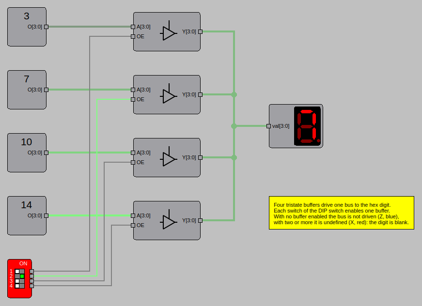
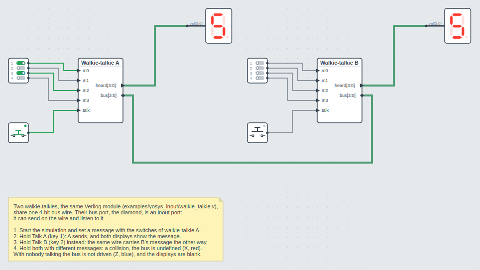
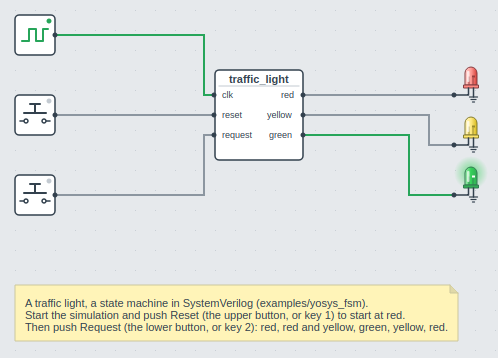
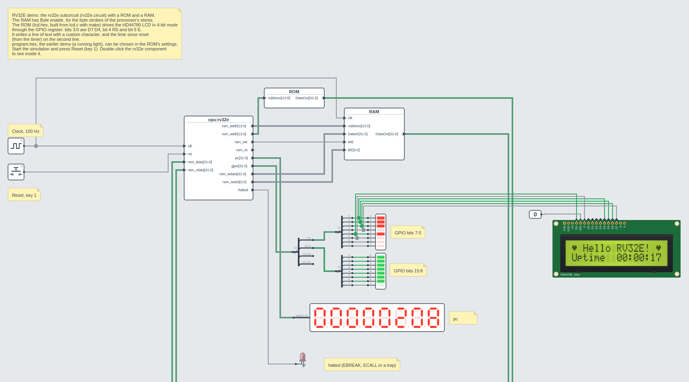
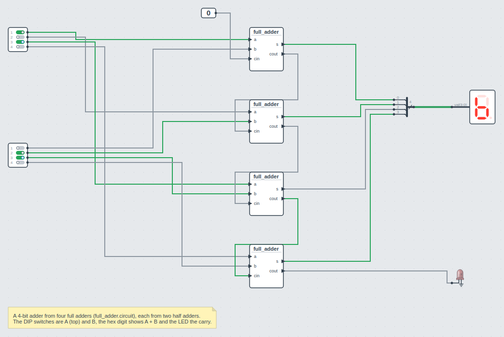

# GUI Examples

Each circuit is in a folder of its own in `circuits/`, with the files it uses, like the
Verilog file of a Verilog component or the circuits of its subcircuits. They come with DigSim:
**File > Examples** copies one to a folder of yours and opens it (see
[Example circuits](gui.md#example-circuits)). In a copy of the repository, open a circuit
with `--load`, then press **Start Simulation** (or **Space**):

```sh
uv run -m digsim.app --load circuits/yosys_counter/counter_yosys_netlist.circuit
```

You can also use **File > Open** in the application. See [GUI Reference](gui.md) for how
to work with the editor.

## Verilog counter

`counter_yosys_netlist.circuit` and `counter_yosys_verilog.circuit` are the same circuit:
the [Verilog counter](python-examples.md#verilog-counter) as a Verilog component, loaded from
the netlist or directly from `counter.v`. Notes in the circuit explain each part:

- a 5 Hz clock drives the counter and an LED,
- a push button resets the counter (shortcut **1**),
- a switch enables counting (shortcut **2**),
- a hex digit shows the counter value,
- a logic analyzer shows the clock, button, switch and the four counter bits, connected
  through Wire Sources/Sinks and a bus splitter,
- a buzzer sounds while the reset button is pressed.


Turn on the switch to start counting.

## 74162 counter

`74162_counter.circuit` rebuilds a classic counter board with two ICs from the built-in IC
library: a 74162 synchronous decade counter and a 7448 BCD to 7-segment decoder.

- A 5 Hz clock drives the counter, and the switch enables counting (`ENP` and `ENT`).
- The 7448 decodes the counter value to the 7-segment display.
- The LED shows the counter's ripple-carry output (`RCO`), which is high on the count of 9.
- The DIP switch sets a value that is loaded with one push button (`Load`), and another push
  button clears the counter (`Clear`). Both inputs are active low, hence the NOT gates.
- The third push button drives the 7448 lamp-test input (`lt`).


## Shift register

`shift_register.circuit` is a 6-bit shift register: six D flip-flops in a chain, clocked
by a 5 Hz clock, with an LED on each output. Press the push button to shift ones into the
register and watch them move along the LEDs.


## Tristate bus

`tristate.circuit` has four static values (3, 7, 10 and 14) that share one 4-bit bus to a
hex digit, each through a tristate buffer. The four switches of the DIP switch enable one
buffer each.

- With one buffer enabled, the hex digit shows its value.
- With no buffer enabled, the bus is not driven (high impedance) and blue. With two or
  more enabled, it is undefined and red. The hex digit is blank in both cases.



## Bidirectional port

`bidirectional_port.circuit` shows a bidirectional bus for a first look: two
walkie-talkies, the same Verilog module
([`walkie_talkie.v`](https://github.com/freand76/digsim/blob/main/circuits/bidirectional_port/walkie_talkie.v))
twice, share one 4-bit bus wire. The bus port of each, drawn as a diamond, is an `inout`
port: it can send on the wire and listen to it. Each walkie-talkie has four switches for
its message, a Talk button, and a hex digit for what it hears on the bus.

- Hold Talk A (shortcut **1**): A sends its message, and both hex digits show it.
- Hold Talk B (shortcut **2**) instead: the same wire carries B's message the other way.
- Hold both, with different messages: the two collide, and the bus is undefined (red).
- With nobody talking the bus is not driven (blue), and the hex digits are blank.



## Traffic light

`traffic_light.circuit` is the [traffic light state machine](python-examples.md#state-machine-traffic-light)
as a Verilog component, made from `traffic_light.sv` with a 4 Hz clock and red, yellow and
green LEDs.

- Push the upper button (shortcut **1**) to reset it to red.
- Push the lower button (shortcut **2**) to request green: red and yellow, green, yellow,
  and red again.



## Buzzers

`buzzers.circuit` has five push buttons, each connected to a buzzer with its own tone
(C, D, E, F and G). Press the buttons, or the shortcut keys **1** to **5**, while the
simulation runs to play a tune.


## RV32E CPU system

`rv32e_demo.circuit` in `circuits/rv32e/` is a small computer: a RISC-V RV32E processor
that runs a C program and writes to an HD44780 character LCD. Start the simulation and
press Reset (shortcut **1**). After a few seconds of simulated time the LCD shows
"Hello RV32E!" between two hearts (a custom character), and the time since reset on the
second line.

- The processor is the `cpu` subcircuit (`cpu.circuit`): the RV32E core in Verilog
  ([`rv32e.v`](https://github.com/freand76/digsim/blob/main/circuits/rv32e/rv32e.v), a
  Verilog component that runs one instruction per clock cycle) with its memory system, an
  arbiter, a GPIO register and a timer, each a subcircuit of its own. Double-click it to
  see inside it, the memory map is in a note there.
- A 100 Hz clock drives it. The ROM holds the program, `rv32e_code/lcd.bin`, and the RAM
  has a byte enable input for the byte strobes of the processor's stores.
- The program drives the LCD in 4-bit mode through byte 0 of the GPIO register: bits 3:0
  are D7:D4, bit 4 is RS and bit 5 is E. Once the text is written, byte 1 (bits 15:8) is a
  running bar that fills up and empties again. The register writes only the bytes of a
  store, so the program writes each byte by itself, as a field of a struct.
- Two LED bars show GPIO bits 7:0 and 15:8, a hex display the program counter, and an LED
  lights when the processor halts (EBREAK, ECALL or a trap).
- `rv32e_code/` has the program's source: `lcd.c`, the startup code `crt0.S` and the
  linker script `link.ld`. `make` there builds `lcd.bin` again with the RISC-V GCC
  (`riscv64-unknown-elf-gcc`).



## Adders from subcircuits

`half_adder.circuit` is a half adder, with In ports for `a` and `b` and Out ports for `s`
and `c`. `full_adder.circuit` is a full adder from two half adder subcircuits and an OR
gate, and `adder_4bit.circuit` a 4-bit adder from four full adder subcircuits. The DIP
switches are A and B, the hex digit shows A + B and the LED the carry. Right-click a
subcircuit and choose **Edit Subcircuit** to open its file in a tab: a change to the half
adder, once it is saved, is in every adder that uses it.


