# GUI Reference

The DigSim application is a circuit editor and simulator in one window. You place
components, connect them with wires, and start the simulation to interact with the
circuit live.

New to DigSim? [Your First Circuit](first-circuit.md) builds a small circuit step by step.

Start it with `digsim-logic-simulator` (or `python -m digsim.app`). See
[Installation](installation.md) for all ways to install and run it. To open a saved
circuit right away, pass it with `--load`:

```sh
digsim-logic-simulator --load example_circuits/counter_yosys_netlist.circuit
```

The [`example_circuits`](https://github.com/freand76/digsim/tree/main/example_circuits)
folder in the repository has ready-made circuits to explore.

## The main window

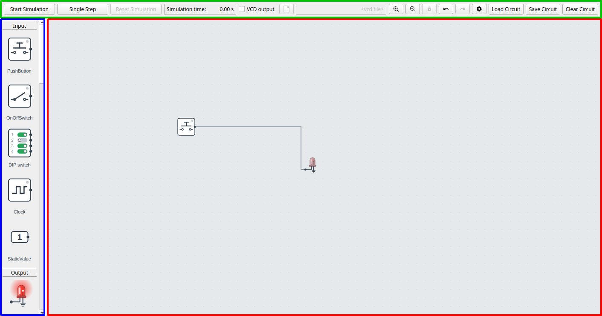{ width="85%" }

The window has three areas:

- **Component selection** (blue, left): all available components, grouped by type.
- **Circuit area** (red, right): the canvas where you build the circuit.
- **Control area** (green, top): simulation controls, VCD output, and buttons for
  loading, saving and clearing circuits, plus **Delete**, **Undo**, **Redo** and
  **Settings**.

A typical circuit consists of:

- one or more [input components](#input-components) such as buttons, switches or clocks,
- some logic, for example [gates](#logic-gates), [flip-flops](#flip-flops) or more
  complex components,
- one or more [output components](#output-components) such as LEDs or hex digits.

## Working with components

Add a component by **double-clicking** it in the component selection, or by **dragging**
it into the circuit area. While you drag, a see-through preview shows where the component
will be placed: centered under the mouse pointer. Components with options open a settings
dialog when they are added.

Right-click a component to open its context menu:

| Menu item | Action |
| --- | --- |
| Bring to front / Send to back | Change the drawing order of overlapping components |
| Delete | Remove the component and its wires |
| Settings | Change the component's options (only for configurable components) |
| Shortcut | Assign a keyboard shortcut (push buttons and switches) |
| Reload | Reload the Verilog file or netlist ([Yosys components](#yosys-component)) |

Click a component to select it, and drag it to move it. Delete the selected component
with the **Del** key or the **Delete** button in the control area.

## Wires

Wires connect component ports. To draw a wire, **click a port, then click the port you
want to connect it to**. Press **Esc** to cancel a wire you have started.

On the way to the second port, each click in the circuit area adds a corner to the wire.
From the port where you started, the wire runs horizontally to the x position of each
click and then vertically to it. Press **Backspace** to remove the last corner. While you
draw, the wire shows the corner that a click at the mouse pointer makes, and the wire
keeps that shape when you click the second port. Only its last bend moves to just before
the port, so that the wire reaches the port horizontally. A wire drawn without clicks to
a port behind the output port gets an automatic route around the component instead.

- One output port can drive any number of input ports, see [Wire trees](#wire-trees).
- Both ends must be of the same kind: a single-bit wire, or a bus of the same width.
  Use the [bus/wire converters](#bus-and-wire-components) to split or merge buses.
- **Wire Source** and **Wire Sink** components connect signals by label instead of with a
  drawn wire, which keeps large circuits readable.

Click a wire to select it. Delete the selected wire with the **Del** key or the
**Delete** button.

### Wire trees

When an output port drives several input ports, the wires can share the way. Point at a
corner of a wire, and the pointer shows a crosshair, like over a port. Click the corner to
start a new wire there, and finish it at an input port like any other wire. A wire can also
be drawn the other way: start it at an input port and click a wire with the same width,
at a corner or anywhere along it. Away from a corner, the click adds a joint there. The
new wire is a branch from the same output port, and a dot shows where it starts. The wires
of one output port make up a wire tree.

To start a wire on a straight part of a wire, add a joint first: right-click the wire
where you want it and choose **Add joint**. The wire keeps its shape and gets a corner
there, shown as a ring while the wire is selected.

- **Select:** a click on a wire selects it from the closest split before the click, where
  the wire splits up or where it starts, to the input ports that it leads to. A click on a
  branch selects the branch up to where it starts, while a click close to the output port
  selects all wires after it.
- **Select the whole tree:** click a selected wire again, or right-click the wire and
  choose **Select wire tree**.
- **Delete:** **Del** deletes the selected part of the tree. The parts that other wires
  still use are kept, and wires that start on a deleted wire keep their shape. Deleting a
  component deletes the wires to it in the same way, up to the closest split.

A new branch leaves a joint, or reaches it, across the wire and not along it: up or down
from a horizontal wire, and to the side from a vertical one. A branch keeps its corner
when the wire it starts on is reshaped: it follows when a segment is dragged, split or
merged.

### Shaping wires

A wire runs in horizontal and vertical segments, and starts and ends horizontally at its
ports. A new wire keeps the shape it was drawn with, and you can change it:

- **Move a segment:** select the wire, and a dot appears in the middle of each segment
  that can be moved. Drag a segment by its dot. Vertical segments move sideways and
  horizontal segments move up and down. The segments at the ports can't be moved.
- **Split a segment:** right-click a segment and choose **Split segment**. This adds a
  small step where you clicked, with two new segments that you can drag into place.
- **Add a joint:** right-click a segment and choose **Add joint**, see
  [Wire trees](#wire-trees). Like a split without a step, it divides the segment in two
  parts that can be dragged on their own.
- **Merge segments:** right-click a segment and choose **Merge segments**, the opposite of
  a split. The segment and its neighbor are removed, and the segments on each side are
  joined into one. A wire always keeps at least one vertical segment.
- **Reset the shape:** right-click the wire and choose **Automatic route** to give it the
  automatic route again, for where its components are now.

When you move a component, only the segments at its ports follow it, and the rest of the
wire keeps its shape. When you move several selected components together, the wires
between them move with them. Every change can be undone with **Ctrl + Z**, and the shape of each
wire is saved with the circuit. Circuits saved by older versions get the automatic route
when they are loaded.

## Simulation

Once the circuit has inputs and outputs, it can be simulated.

| Control | Action |
| --- | --- |
| **Start Simulation** / **Stop Simulation** (or **Space**) | Run or pause the simulation |
| **Single Step** | Run until the next input event, such as a clock edge |
| **Reset Simulation** | Restart the simulation from time zero |

While the simulation runs:

- click a **push button** to press it, and click a **switch** to toggle it,
- use keyboard [shortcuts](#keyboard-shortcuts-for-inputs) to operate buttons and switches,
- the current simulation time is shown in the control area.

The circuit cannot be edited while the simulation is running.

### Application settings

The **Settings** button in the control area opens the application settings:

| Setting | Description |
| --- | --- |
| GUI Update Frequency | How often the display is refreshed (1–100 Hz) |
| Slow down sim to 'Real Time' | Keep simulation time in step with wall-clock time |
| Show Wire Value | Color wires by their current logic level |

### VCD output

Check **VCD output** in the control area to record all signals to a
[VCD file](https://en.wikipedia.org/wiki/Value_change_dump) while simulating. Open the
file in [GTKWave](https://gtkwave.sourceforge.net/) or a similar waveform viewer.

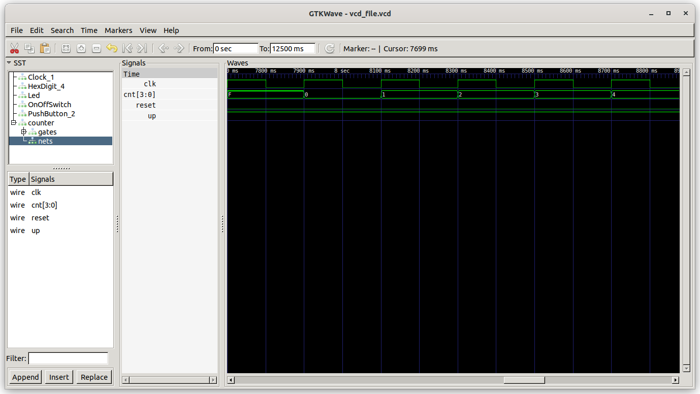{ width="85%" }

## Navigation and keyboard

| Key / mouse | Action |
| --- | --- |
| **Ctrl + mouse wheel** | Zoom in and out around the mouse pointer |
| **Ctrl + +** / **Ctrl + -** | Zoom in / out |
| **Shift + drag** | Pan the circuit area |
| **Ctrl + Z** / **Ctrl + Y** | Undo / redo |
| **Del** | Delete the selected components and wires |
| **Space** | Start / stop the simulation |
| **Esc** | Cancel the wire being drawn |
| **Backspace** | Remove the last corner of the wire being drawn |

### Keyboard shortcuts for inputs

Push buttons and on/off switches can be bound to the keys **0**–**9**. Right-click the
component, choose **Shortcut**, and pick a number. While the simulation runs, the key
presses the button or toggles the switch.

## Component reference

### Input components

| Component | Description |
| --- | --- |
|  | **Push Button**: outputs a high level while it is pressed. |
|  | **On/Off Switch**: toggles its output each time it is clicked. |
| 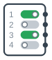 | **DIP Switch**: a row of switches, one output per switch. |
|  | **Clock**: a square wave with a configurable frequency (1–50 Hz). |
|  | **Static Value**: a constant value on a wire or a bus (1–16 bits). |

### Output components

| Component | Description |
| --- | --- |
|  | **LED**: lights up when driven by a logic high. |
| 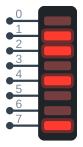 | **LED Bar**: a row of 1–16 LEDs showing the bits of a bus, the most significant bit to the left. |
| 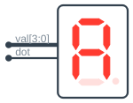 | **Hex Digit**: shows a bus value in hexadecimal, with 1–8 digits (4 bits each) and an optional decimal point. |
| 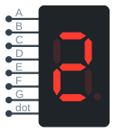 | **7-Segment Display**: like a hex digit, but each segment is controlled individually. |
|  | **Buzzer**: plays a tone, with a selectable note, when its input is high. |
| 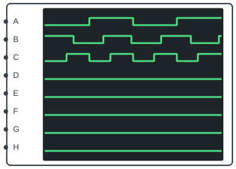 | **Logic Analyzer**: plots signal levels over time, live. |

### Logic gates

      

OR, AND, NOT, XOR, XNOR, NAND and NOR. All gates except NOT can be configured with 2 to 8
inputs. With more than two inputs, XOR is high when an odd number of inputs are high, and
XNOR when an even number are.

### Flip-flops

| Component | Description |
| --- | --- |
| 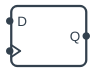 | **D Flip-Flop**: 1–32 bits wide, with optional clock enable and asynchronous reset. |
| 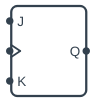 | **Flip Flop**: choose an SR flip-flop, or an edge-triggered SR, JK or T flip-flop. |

### Multiplexer

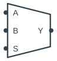

The multiplexer has 2, 4 or 8 inputs and a data width between 1 and 32 bits.

### Bus and wire components

- **Bus2Wires** splits a bus into individual bits.
- **Wires2Bus** merges individual bits into a bus.
- **Wire Source** / **Wire Sink** connect signals by label, see [Wires](#wires).

### IC components

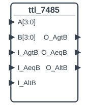

ICs are pre-synthesized Yosys netlists of classic logic chips. When you add one, type in
the search field to find it: a number (`741`), a word of the description (`counter`,
`shift`), or several words. Skipped letters are fine too. Press **Enter** or double-click
to add the selected IC. Pins with names ending in `_bar` are active low.

| IC | Description |
| --- | --- |
| 74181 | 4-bit ALU with 16 logic and 16 arithmetic functions |
| 74182 | Look-ahead carry generator for four 74181s |
| 74283 | 4-bit binary full adder with fast carry |
| 7485 | 4-bit magnitude comparator, cascadable |
| 74138 | 3-to-8 line decoder with active-low outputs |
| 74151 | 8-to-1 multiplexer |
| 74162 | Synchronous decade counter with parallel load |
| 74193 | Up/down binary counter with separate up and down clocks |
| 74194 | 4-bit bidirectional universal shift register |
| 74595 | 8-bit shift register with an output register (always enabled) |
| 7448 | BCD to 7-segment decoder |
| 4017 | Decade counter with 10 decoded outputs |
| 4511 | BCD to 7-segment latch and decoder |

More ICs can be added by placing Yosys JSON netlists in the
[`src/digsim/circuit/components/ic`](https://github.com/freand76/digsim/tree/main/src/digsim/circuit/components/ic)
folder.

### Yosys component

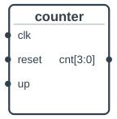

A Yosys component gets its behavior from your own Verilog. When you add one, a file
dialog asks for either a **Verilog file** or a **Yosys netlist** in JSON format. Verilog
files are synthesized automatically when loaded. Check **Synthesize Verilog into
functional blocks** in the dialog after the file for a faster simulation, see
[Gates or functional blocks](synthesis.md#gates-or-functional-blocks). Check **Write the
internal signals to the VCD file** to see the wires and registers inside the design in
the waveforms, with the signals to show as state names in the text field below it, see
[Internal signals and states](synthesis.md#internal-signals-and-states). See
[Verilog and Yosys](synthesis.md) for how to create netlists.

!!! note
    A Verilog file loaded directly can only contain one module. Synthesize designs with
    several modules into a netlist first.

After changing your design, right-click the component and choose **Reload** to load the
new version without rebuilding the circuit. A typical development loop is:

1. Write or update the Verilog design.
2. (Netlists only) Run Yosys synthesis.
3. Right-click the component and choose **Reload**.
4. Simulate and test.

!!! warning
    The module interface, i.e. the names and widths of the input and output ports, must
    not change between load and reload.

### Notes

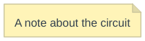

Notes add free text to the circuit, for example to explain how it works.
