# GUI Reference

The DigSim application is a circuit editor and simulator in one window. You place
components, connect them with wires, and start the simulation to interact with the
circuit live.

New to DigSim? [Your First Circuit](first-circuit.md) builds a small circuit step by step.

Start it with `digsim-logic-simulator` (or `python -m digsim.app`). See
[Installation](installation.md) for all ways to install and run it. To open a saved
circuit right away, pass it with `--load`:

```sh
digsim-logic-simulator --load example_circuits/counter_yosys_netlist.circuit
```

The [`example_circuits`](https://github.com/freand76/digsim/tree/main/example_circuits)
folder in the repository has ready-made circuits to explore.

## The main window

{ width="85%" }

The window has a menu bar and three areas:

- **Menu bar** (top): **File** (New Tab, New, Open, Open Recent, Save, Save As, Export
  Image, Close Tab, Quit), **Edit** (Undo, Redo, Cut, Copy, Paste, Duplicate, Delete,
  Rotate, Find Component, Settings), **View** (zoom in and out, and Zoom to Fit: the
  whole circuit in the window), **Simulation** (Start, Single Step, Step Clock, Reset)
  and **Help** (the documentation, and the version of DigSim). Save saves the circuit in
  the file it was opened from or saved to, the window title shows that file, with a `*`
  when the circuit has changed since.
- **Component selection** (blue, left): all available components, grouped by type, with
  a search field above them. Press **Ctrl + K** (or **Ctrl + F**, **Edit > Find
  Component**) and type a few letters of a component, like `led`, `flp` or `mem`: the
  components that match are listed, the best first. Drag one into the circuit area, or
  press **Enter** to add the first one (the arrow keys choose another). **Esc** clears the
  search.
- **Circuit area** (red, right): the canvas where you build the circuit.
- **Control area** (green, top): simulation controls, VCD output, and buttons for
  loading, saving and clearing circuits, plus **Delete**, **Undo**, **Redo** and
  **Settings**.

Each circuit is in a tab of its own: **File > New Tab** opens an empty one, and Open
opens a circuit in a new tab (or in an empty one). A circuit that is open already gets its
tab shown. The tab bar is shown with two tabs or more. Only the tab that is shown
simulates: switching to another tab stops the simulation of the one that is left, and
Start goes on from where it was.

A typical circuit consists of:

- one or more [input components](#input-components) such as buttons, switches or clocks,
- some logic, for example [gates](#logic-gates), [flip-flops](#flip-flops) or more
  complex components,
- one or more [output components](#output-components) such as LEDs or hex digits.

## Working with components

Add a component by **double-clicking** it in the component selection, or by **dragging**
it into the circuit area. While you drag, a see-through preview shows where the component
will be placed: centered under the mouse pointer. Components with options open a settings
dialog when they are added.

Right-click a component to open its context menu:

| Menu item | Action |
| --- | --- |
| Rotate | Turn the component a quarter clockwise (gates and the other symbols, see [Rotating components](#rotating-components)) |
| Bring to front / Send to back | Change the drawing order of overlapping components |
| Delete | Remove the component and its wires |
| Settings | Change the component's options (only for configurable components) |
| Shortcut | Assign a keyboard shortcut (push buttons and switches) |
| Edit Verilog... | Open the Verilog file in an editor ([Yosys components](#yosys-component)) |
| Reload | Reload the Verilog file or netlist ([Yosys components](#yosys-component)) |

Click a component to select it, and drag it to move it. Delete the selected component
with the **Del** key or the **Delete** button in the control area.

### Rotating components

Components drawn as a symbol (the gates, the tristate buffer, the multiplexer, the
decoder and the demultiplexer, Bus2Wires, Wires2Bus and the Splitter) can be rotated:
**Rotate** in the context menu, or **Ctrl + R** for the selected components, turns each a
quarter clockwise around its middle. The wires to a rotated component get a new route,
that leaves and reaches its ports in the directions they face, up or down too. The text
of a rotated symbol reads from below or from the right. Components with a body, like the
switches, the LEDs and the ICs, keep their direction.

## Wires

Wires connect component ports. To draw a wire, **click a port, then click the port you
want to connect it to**. Press **Esc** to cancel a wire you have started.

A port is a dot. The ports of an IC or a Verilog component are arrows that show their
direction: an input points into the component, an output out of it, and an inout port
is a diamond.

On the way to the second port, each click in the circuit area adds a corner to the wire.
From the port where you started, the wire runs horizontally to the x position of each
click and then vertically to it. Press **Backspace** to remove the last corner. While you
draw, the wire shows the corner that a click at the mouse pointer makes, and the wire
keeps that shape when you click the second port. Only its last bend moves to just before
the port, so that the wire reaches the port horizontally. A wire drawn without clicks to
a port behind the output port gets an automatic route around the component instead.

- One output port can drive any number of input ports, see [Wire trees](#wire-trees).
- Any number of outputs can drive the same input port, like the outputs of the chips on
  a bus: with a wire of its own to the port, or ending on the line of another output, see
  [Lines](#lines). The input has the value that they drive, and it is
  undefined if they drive different values. A [tristate buffer](#bus-and-wire-components)
  that is disabled doesn't drive, so the others decide.
- A wire can also connect two input ports, or two output ports. Their lines become one,
  so an output on either line drives the inputs of both, see [Lines](#lines).
- Both ends must be of the same kind: a single-bit wire, or a bus of the same width.
  Use the [bus/wire converters](#bus-and-wire-components) to split or merge buses.
- **Wire Source** and **Wire Sink** components connect signals by label instead of with a
  drawn wire, which keeps large circuits readable.

Click a wire to select it. Delete the selected wire with the **Del** key or the
**Delete** button.

### Wire trees

When an output port drives several input ports, the wires can share the way. To start a
new wire on a wire, right-click the wire where you want it to start and choose **Start
wire here**, then finish the wire at an input port like any other wire. A wire can also
be drawn the other way: start it at an input port and click a wire with the same width,
at a corner or anywhere along it, where the pointer shows a crosshair. The new wire is a
branch from the same output port, and a dot shows where it starts. The wires of one
output port make up a wire tree.

A dot shows where the wires of a line meet. Click a dot to select it, and drag it to move
it along the straight line through it, between the corners on each side: the wires there
follow it, and a wire to a port gets a step next to the port. Click it again to select the wires that meet there, and once more for the
whole line. Where a wire starts on a straight part of another wire, that wire gets a
joint: a corner in a straight line, shown as a ring while the wire is selected. A joint
is selected and moved like a dot.

- **Select:** a click on a wire selects the piece of it that you clicked: from the
  closest port or dot on one side to the closest port or dot on the other.
- **Select the whole line:** click a selected wire again, or right-click the wire and
  choose **Select wire tree**.
- **Delete:** **Del** deletes the selected pieces, and the rest of the line keeps its
  shape. The ports that the line doesn't connect any more are disconnected, and a part of
  the line that reaches only one port is deleted too. Deleting a component deletes the
  wires to it, up to the closest dot.

A new branch leaves a joint, or reaches it, across the wire and not along it: up or down
from a horizontal wire, and to the side from a vertical one. A branch keeps its corner
when the wire it starts on is reshaped: it follows when a segment is dragged, split or
merged.

### Lines

Wires that are connected, at a port or where one starts or ends on another, make a line,
like one wire of a real circuit. Each output port on a line drives each input port on it.
The inputs have the value that the outputs drive, and it is undefined if they drive
different values.

An inout port of a Verilog component, drawn as a diamond, is an output and an input: it
drives the line and reads it, like a pin on a bidirectional bus. Draw a wire from it like
from an output. Two inout ports on a line drive each other, so a value can go both ways
on the same wire, see the [walkie-talkie example](examples.md#walkie-talkies).

A new wire can end on any wire, at a corner or anywhere along it, and the pointer shows a
crosshair where it can. A wire from an input port is a branch there, and a wire from an
output port joins the line, like a chip that is connected to a bus. A wire started on a
line with **Start wire here** can also end at an output port, or on a wire of another
line. A dot shows where the wires of a line meet.

- A new wire connects two lines, which become one line: all their outputs drive all
  their inputs. This is the same for a wire between two ports, of any kind, when one of
  them is on a line already.
- The lines must have the same width. On a wire of its own line, or of another width, a
  click is a corner of the wire.
- **Select wire tree** selects all wires of the line.
- When wires are deleted, the ports that no line connects any more are disconnected. A
  wire that ended on a deleted wire ends on another wire of its line that runs where it
  ended, if there is one, and is deleted otherwise.

### Shaping wires

A wire runs in horizontal and vertical segments, and starts and ends horizontally at its
ports. A new wire keeps the shape it was drawn with, and you can change it:

- **Move a segment:** select the wire, and a dot appears in the middle of each segment
  that can be moved. Drag a segment by its dot. Vertical segments move sideways and
  horizontal segments move up and down. A segment at a port gets a step next to the
  port when it is dragged, so the wire still leaves or reaches the port straight.
- **Split a segment:** right-click a segment and choose **Split segment**. This adds a
  small step where you clicked, with two new segments that you can drag into place.
- **Move a dot or a joint:** drag it along the straight line through it, see
  [Wire trees](#wire-trees).
- **Merge segments:** right-click a segment and choose **Merge segments**, the opposite of
  a split. The segment and its neighbor are removed, and the segments on each side are
  joined into one. A wire always keeps at least one vertical segment. Next to a joint
  that no wire starts on, the two segments in a straight line become one instead, and the
  joint is gone.
- **Reset the shape:** right-click the wire and choose **Automatic route** to give it the
  automatic route again, for where its components are now.

When you move a component, only the segments at its ports follow it, and the rest of the
wire keeps its shape. When you move several selected components together, the wires
between them move with them. Every change can be undone with **Ctrl + Z**.

The circuit file stores each [line](#lines) with the shape of its wires, and the
connections follow from the lines. Circuits saved by older versions load with their wires,
and are saved in this form. Circuits without wire shapes get the automatic route.

## Simulation

Once the circuit has inputs and outputs, it can be simulated.

| Control | Action |
| --- | --- |
| **Start Simulation** / **Stop Simulation** (or **Space**) | Run or pause the simulation |
| **Single Step** | Run until the next input event, such as a clock edge |
| **Reset Simulation** | Restart the simulation from time zero |

While the simulation runs:

- click a **push button** to press it, and click a **switch** to toggle it,
- use keyboard [shortcuts](#keyboard-shortcuts-for-inputs) to operate buttons and switches,
- the current simulation time is shown in the control area,
- the wires show their values: gray for 0, green for 1 (brighter for a higher bus
  value), red for an undefined value and blue for a wire that is not driven (high
  impedance, all its tristate drivers are disabled). All wires of a [line](#lines) have
  the value that its outputs drive together, so the whole line is red when they drive
  different values, also when it has no input.

The circuit cannot be edited while the simulation is running.

### Application settings

The **Settings** button in the control area opens the application settings:

| Setting | Description |
| --- | --- |
| GUI Update Frequency | How often the display is refreshed (1–100 Hz) |
| Slow down sim to 'Real Time' | Keep simulation time in step with wall-clock time |
| Show Wire Value | Color wires by their current logic level |

### VCD output

Check **VCD output** in the control area to record all signals to a
[VCD file](https://en.wikipedia.org/wiki/Value_change_dump) while simulating. Open the
file in [GTKWave](https://gtkwave.sourceforge.net/) or a similar waveform viewer.

The file starts over when the simulation restarts from time 0: on **Reset**, when a
component is added, on undo and redo, and when a circuit is opened. The file lists its
signals at the top, so it can't go on after the circuit changes. Copy the file first to
keep the waves recorded so far.

{ width="85%" }

## Copy and paste

**Ctrl + C** copies the selected components, with the wires between them. A wire is only
copied with the components at both its ends: with nothing but wires selected, nothing is
copied, the clipboard keeps what it has, and a message says so. **Ctrl + V** pastes the
copied components at the mouse pointer, or a step down and to the right of the copied
ones when the pointer is outside the circuit area. The pasted components get new names
where theirs are taken, and are selected, so they can be moved at once. **Ctrl + X** cuts
the selected components, and **Ctrl + D** duplicates them without the clipboard. The
clipboard is shared, so components can be copied from one DigSim window to another. A
paste is one step to undo.

## Navigation and keyboard

| Key / mouse | Action |
| --- | --- |
| **Ctrl + mouse wheel** | Zoom in and out around the mouse pointer |
| **Ctrl + +** / **Ctrl + -** | Zoom in / out |
| **Shift + drag** | Pan the circuit area |
| **Ctrl + T** / **Ctrl + W** | New tab / close the tab |
| **Ctrl + N** | New circuit |
| **Ctrl + O** | Open a circuit |
| **Ctrl + S** / **Ctrl + Shift + S** | Save / save as |
| **Ctrl + E** | Export the circuit as an image, PNG or SVG |
| **Ctrl + Q** | Quit |
| **Ctrl + K** / **Ctrl + F** | Find a component to add |
| **Ctrl + Z** / **Ctrl + Y** | Undo / redo (also **Ctrl + Shift + Z**) |
| **Ctrl + C** / **Ctrl + X** / **Ctrl + V** | Copy / cut / paste the selected components |
| **Ctrl + D** | Duplicate the selected components |
| **Ctrl + R** | Rotate the selected components a quarter clockwise |
| **Ctrl + 0** / **Home** | Zoom to fit the whole circuit |
| **Del** | Delete the selected components and wires |
| **Space** | Start / stop the simulation |
| **F10** | Step Clock: run to the next rising edge of a clock, and let the logic settle |
| **Esc** | Cancel the wire being drawn |
| **Backspace** | Remove the last corner of the wire being drawn |
| **F1** | Open the documentation |

### Keyboard shortcuts for inputs

Push buttons and on/off switches can be bound to the keys **0**–**9**. Right-click the
component, choose **Shortcut**, and pick a number. While the simulation runs, the key
presses the button or toggles the switch.

## Component reference

### Input components

| Component | Description |
| --- | --- |
|  | **Push Button**: outputs a high level while it is pressed. |
|  | **On/Off Switch**: toggles its output each time it is clicked. |
|  | **DIP Switch**: a row of switches, one output per switch. |
|  | **Clock**: a square wave with a configurable frequency (1–50 Hz). |
|  | **Static Value**: a constant value on a wire or a bus (1–16 bits). |

The switches can also be clicked while the simulation is stopped, to set the inputs before
it starts or before **Step Clock**. The circuit then runs for a moment (10 µs) so that the
change goes through it, and the outputs show it at once.

### Output components

| Component | Description |
| --- | --- |
|  | **LED**: lights up when driven by a logic high. Red, green, blue or yellow, chosen in its settings. |
|  | **LED Bar**: a column of 1–16 LEDs, each with an input of its own, LED 0 at the top, in one of the LED colors. It fits next to a DIP switch. |
|  | **Hex Digit**: shows a bus value in hexadecimal, with 1–8 digits (4 bits each) and an optional decimal point. |
|  | **7-Segment Display**: like a hex digit, but each segment is controlled individually. |
|  | **Buzzer**: plays a tone, with a selectable note, when its input is high. |
|  | **Logic Analyzer**: plots signal levels over time, live. A sample at the time an input changes, like at a clock edge, shows the value from just before. Reset clears it. |
|  | **Probe**: shows the value of a wire or a bus (1–32 bits) in hexadecimal, decimal or binary, "X" in red when it is undefined and "Z" in blue when nothing drives it. Right-click a wire and choose **Add probe** to put one on it. The radix can be changed in its settings. |

### Logic gates

      

OR, AND, NOT, XOR, XNOR, NAND and NOR. All gates except NOT can be configured with 2 to 8
inputs. With more than two inputs, XOR is high when an odd number of inputs are high, and
XNOR when an even number are.

### Flip-flops

| Component | Description |
| --- | --- |
|  | **D Flip-Flop**: 1–32 bits wide, with optional clock enable and asynchronous reset. A wide one is a register. |
|  | **Flip Flop**: choose an SR flip-flop, or an edge-triggered SR, JK or T flip-flop. |
| 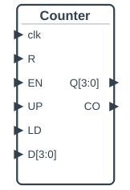 | **Counter**: 1–32 bits, counts on the rising edge of clk and wraps around. R resets it to 0 at once. Optional: a clock enable EN, a direction input UP (1 up, 0 down), and LD to load D. CO is 1 at the last count before it wraps. |

### Multiplexer, decoder and demultiplexer


The multiplexer has 2, 4, 8 or 16 inputs and a data width between 1 and 32 bits.

| Component | Description |
| --- | --- |
| 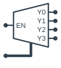 | **Decoder**: the output that S selects is 1, the others 0. 1–4 select bits (2–16 outputs), and an optional enable input EN. |
| 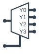 | **Demux**: the output that S selects is the input I, the others 0. 1–4 select bits, 1–32 bits wide. |

### Arithmetic components

They work on unsigned numbers of 1–32 bits. An input that is undefined makes the outputs
undefined.

| Component | Description |
| --- | --- |
| 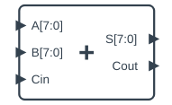 | **Adder**: S = A + B, with the carry out Cout. An optional carry input Cin chains adders. |
| 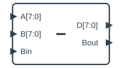 | **Subtractor**: D = A − B, Bout is 1 when it borrows. An optional borrow input Bin chains subtractors. |
| 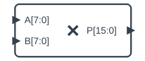 | **Multiplier**: P = A × B, twice as wide as A and B (up to 16 bits). |
| 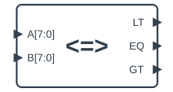 | **Comparator**: LT, EQ or GT is 1 for A < B, A = B or A > B, unsigned or signed (two's complement). |
| 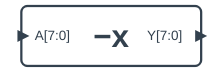 | **Negator**: Y = −A, in two's complement. |

### Bus and wire components

- **Bus2Wires** splits a bus into individual bits.
- **Wires2Bus** merges individual bits into a bus.
- **Splitter** splits a bus into groups of bits, like [7:4] and [3:0], or merges groups
  into a bus. Its groups are the widths from bit 0: `4, 4` is two groups of 4 bits.
- **Wire Source** / **Wire Sink** connect signals by label, see [Wires](#wires).

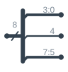


The **Tristate Buffer** drives its input A to its output Y while its output enable OE is
high, or low if it is set to be active low. Otherwise it does not drive Y at all (high
impedance). It is a wire or a bus of 1–32 bits. The outputs of several tristate buffers
can be connected to the same input, and the one that is enabled drives it. If more than
one is enabled with different values, the value is undefined.

### Memory components

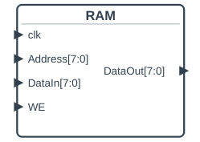 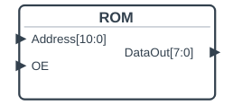

The **RAM** and the **ROM** have 2^n words, with an address width of 1–20 bits, and a
data width of 1–32 bits. The mode sets how they are clocked:

| Mode | RAM | ROM |
| --- | --- | --- |
| sync | DataIn is written while WE is 1, or DataOut read, on the clock edge | DataOut is read on the clock edge |
| async_read | DataIn is written on the clock edge while WE is 1, DataOut is the word at the address at all times | |
| async | No clock. DataIn is written while WE is 1, DataOut is the word at the address at all times | No clock, DataOut is the word at the address at all times |

The clock edge is rising or falling. With **Output enable input**, the memory has an OE
input, and DataOut is not driven while it is low, so several memories can share a data
bus.

The ROM is filled from a file, chosen when it is added. A RAM can start with the contents
of a file, and is otherwise filled with zeros. Reset fills it from the file again. A file
ending in `.hex`, `.mem` or `.txt` has hexadecimal words separated by whitespace, like
Verilog's `$readmemh` reads, with `//` comments and `@address` to continue at an address.
Other files are binary, with the bytes of a word wider than 8 bits in little-endian
order. The file is stored relative to the circuit file.

### Circuit ports

| Component | Description |
| --- | --- |
|  | **In**: an input of the circuit, 1–32 bits. It drives a value, 0 at the start: **Set Value...** in its context menu sets it, typed as hexadecimal (`0x2A`), binary (`0b101`) or decimal. A click on a 1-bit In toggles it. |
|  | **Out**: an output of the circuit, it shows the value of its wire. |
|  | **InOut**: an inout port of the circuit. It shows the value of its wire, and drives a value set with **Set Value...**, or nothing (`Z`) as at the start. |

The circuit ports make the interface of a circuit: their names (unique in the circuit)
and widths are the ports of the circuit when it is used as a subcircuit. In the circuit
itself they work as inputs and outputs, so that it can be tested on its own.

### Subcircuits

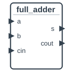

A **Subcircuit** uses another circuit file as a component: choose the file when you add
it. Its ports are the circuit ports (In, Out and InOut) of the file, named like them, in
the order they are in the file from top to bottom, and it works like the circuit in the
file. A subcircuit can use subcircuits, but not the circuit it is in.

**View Subcircuit** in its context menu shows what is inside this subcircuit, in a tab:
its parts and wires, drawn like its file, with the values of the simulation of the
circuit it is in. The view is read-only, and the simulation goes on when it is shown. A
subcircuit in it has View Subcircuit too, to look further inside. Closing the circuit's
tab closes its views.

**Edit Subcircuit** in its context menu opens its file in a tab (or shows its tab). That
edits the file, which every subcircuit of it uses: when the file is saved, the subcircuits
of it in the other tabs are built again from it, also the ones that use it through their
own subcircuits. **Reload** builds a subcircuit again from its file, after it was changed
elsewhere. When the ports of the file have changed, the changes are listed first, and the
wires to the ports that are gone are removed.

### IC components


ICs are pre-synthesized Yosys netlists of classic logic chips. When you add one, type in
the search field to find it: a number (`741`), a word of the description (`counter`,
`shift`), or several words. Skipped letters are fine too. Press **Enter** or double-click
to add the selected IC. Pins with names ending in `_bar` are active low.

| IC | Description |
| --- | --- |
| 74181 | 4-bit ALU with 16 logic and 16 arithmetic functions |
| 74182 | Look-ahead carry generator for four 74181s |
| 74283 | 4-bit binary full adder with fast carry |
| 7485 | 4-bit magnitude comparator, cascadable |
| 74138 | 3-to-8 line decoder with active-low outputs |
| 74139 | Dual 2-to-4 line decoder with active-low outputs |
| 74148 | 8-to-3 line priority encoder, active low, cascadable (EI_bar, EO_bar) |
| 74151 | 8-to-1 multiplexer |
| 74157 | Quad 2-to-1 multiplexer |
| 74161 | Synchronous 4-bit binary counter with parallel load, asynchronous clear |
| 74162 | Synchronous decade counter with parallel load |
| 74163 | Synchronous 4-bit binary counter with parallel load, synchronous clear |
| 74164 | 8-bit serial-in, parallel-out shift register |
| 74165 | 8-bit parallel-in, serial-out shift register |
| 74173 | 4-bit D register with tristate outputs |
| 74193 | Up/down binary counter with separate up and down clocks |
| 74194 | 4-bit bidirectional universal shift register |
| 74245 | Octal bus transceiver: A to B or B to A by DIR, inout ports |
| 74374 | Octal D flip-flops with tristate outputs |
| 74574 | Octal D flip-flops with tristate outputs, the 74374 with another pinout |
| 74595 | 8-bit shift register with an output register and tristate outputs (output enable OE_bar) |
| 7448 | BCD to 7-segment decoder |
| 4017 | Decade counter with 10 decoded outputs |
| 4021 | 8-stage parallel-in, serial-out shift register |
| 4029 | Presettable up/down counter, binary or decade |
| 4094 | 8-stage shift-and-store bus register with tristate outputs |
| 4511 | BCD to 7-segment latch and decoder |

More ICs can be added by placing Yosys JSON netlists in the
[`src/digsim/circuit/components/ic`](https://github.com/freand76/digsim/tree/main/src/digsim/circuit/components/ic)
folder.

### Yosys component


A Yosys component gets its behavior from your own Verilog. When you add one, DigSim asks
if you want to open a file or start a new Verilog file. **Open a file** opens a file
dialog for either a **Verilog file** or a **Yosys netlist** in JSON format. Verilog
files are synthesized automatically when loaded. Check **Synthesize Verilog into
functional blocks** in the dialog after the file for a faster simulation, see
[Gates or functional blocks](synthesis.md#gates-or-functional-blocks). Check **Write the
internal signals (wires and registers) to the VCD file, states also with their names** to
see the wires and registers inside the design in the waveforms. A signal with names for
its values, like the state of a state machine, is also written with the names, as
`state_name` next to `state`, see
[Internal signals and states](synthesis.md#internal-signals-and-states). See
[Verilog and Yosys](synthesis.md) for how to create netlists.

A netlist is not synthesized, so it only asks for the internal signals. These settings
can be changed later: right-click the component and choose **Settings**. The component is
built again with them (a Verilog file is synthesized again when **Synthesize Verilog into
functional blocks** changes), and the simulation starts over at time 0. The wires stay
where they are.

To start a new design, choose **New Verilog file** and give the new file a name (`.v`
is added if you leave it out). DigSim creates it with a small module (one input and one
output, named after the file), adds the component, and opens the file in the
[Verilog editor](#the-verilog-editor). If a file with that name exists, DigSim asks if it
should use the file as it is, or if you want to choose another name. The file is never
replaced. A few folders can't be used, like `/tmp` on Linux, as Yosys can't read files
there, see [Verilog and Yosys](synthesis.md#verilog-and-yosys). DigSim says so when
you choose one.

!!! note
    A Verilog file loaded directly can only contain one module. Synthesize designs with
    several modules into a netlist first.

After changing your design, right-click the component and choose **Reload** to load the
new version without rebuilding the circuit. A typical development loop is:

1. Write or update the Verilog design.
2. (Netlists only) Run Yosys synthesis.
3. Right-click the component and choose **Reload**.
4. Simulate and test.

**Reload** always synthesizes the Verilog again, so it also picks up a change in a file
that the design reads, like an `` `include `` file or a `$readmemh` data file. Undo, redo
and loading a circuit use the netlist of the last synthesis of the same Verilog file.

Every component made from the same file is reloaded. If the ports of the module change,
a dialog lists the changes and the wires that are removed with them: the wires to ports
that are gone, or that have another width or direction. New ports are added unconnected.
The circuit is then built again, and the changes before the reload can't be undone.

#### The Verilog editor

Right-click a Yosys component made from a Verilog file and choose **Edit Verilog...** to
open the file in an editor window, one window for each file. The editor colors the
Verilog, shows line numbers, and highlights the bracket that matches the one at the
cursor.

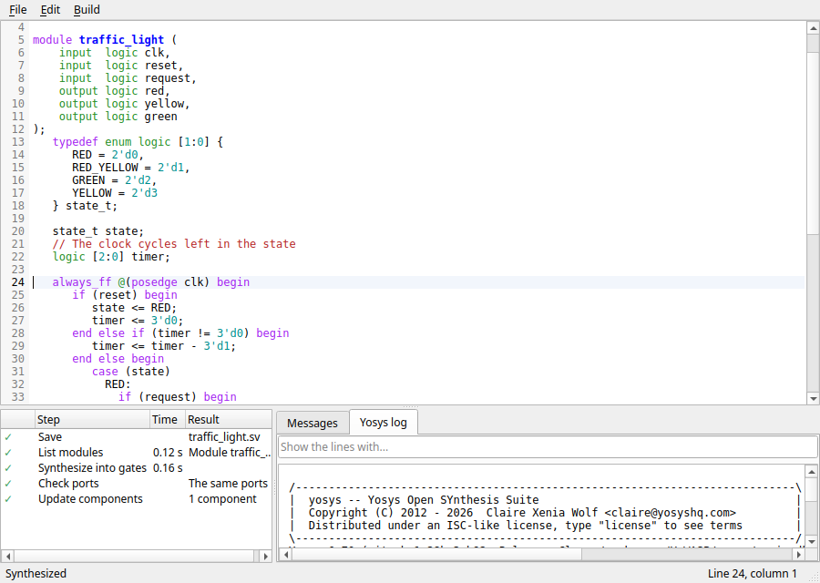

[Your First Verilog Component](new-verilog.md) and
[Editing a Verilog Component](verilog-tutorial.md) are step by step guides to the editor.

| Keys | Action |
| --- | --- |
| Ctrl+S | Save |
| Tab / Shift+Tab | Indent or unindent the selected lines (Tab inserts spaces) |
| Enter | A new line with the indentation of the line, one step more after `begin` or an open bracket |
| Ctrl+/ | Comment out the selected lines, or remove their comments |
| Ctrl+F / Ctrl+H | Find, find and replace |
| F3 / Shift+F3 | Find the next or the previous match |
| Ctrl+G | Go to a line |
| Ctrl+Shift+I | Format the file, see [Formatting Verilog](synthesis.md#formatting-verilog) |

**Build > Synthesize** (Ctrl+B) saves the file and synthesizes it, while the circuit keeps
running. The panel below the text shows each step with its time, the errors and warnings
of Yosys (double-click one to go to its line, which is also underlined in the text), and
the whole Yosys log. When it succeeds, every component made from the file is updated,
synthesized into gates or functional blocks as before. If the ports change, it asks first,
as **Reload** does.

**File > Revert to saved** loads the file again without your changes. When another
program changes the file, the editor loads it, and asks first if you have changes that
are not saved. Closing the editor, or DigSim, asks to save your changes. When the components of the file
were not updated with the saved file, closing the editor offers to synthesize it first:
the editor closes when the components are updated, and stays open if the synthesis
fails.

### Notes


Notes add free text to the circuit, for example to explain how it works.
