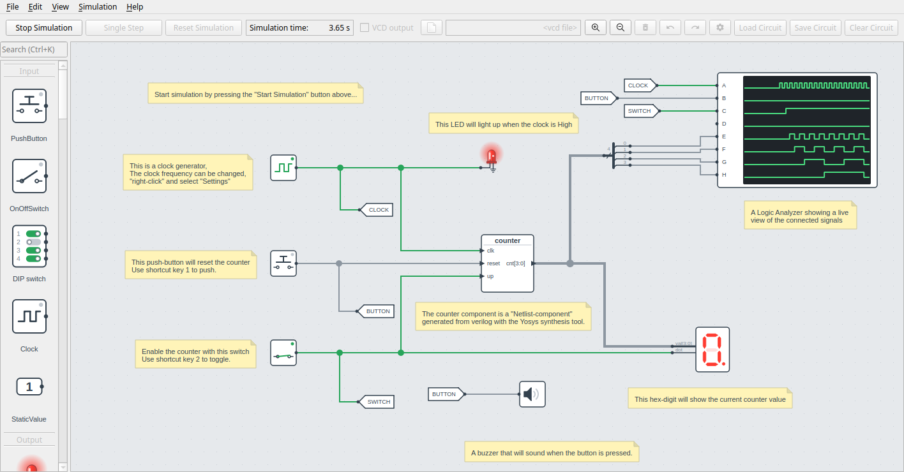

# DigSim

**DigSim is an interactive digital logic simulator written in Python.**

It is made for learning and experimenting with digital logic, from single gates to
complete Verilog designs. Build a circuit by dragging components onto a canvas, start
the simulation, and press buttons, flip switches and watch LEDs and hex displays react
in real time.

{ width="85%" }

## Why DigSim?

Simulating a Verilog or VHDL design normally means writing test stimuli and reading
waveforms afterwards, which is not a very interactive way of working. Testing the design
on an FPGA gives you real buttons and LEDs, but synthesis and programming take time
(and sometimes money), so every change has a long turnaround.

DigSim sits in between. You can load a Verilog module straight into the simulator, wire
it to buttons, switches and displays, and play with it immediately. Edit the Verilog,
reload the component, and try again.

DigSim started as a way to visualize simple Verilog modules. It has since been used to
simulate larger designs, such as the classic
[6502 CPU](https://en.wikipedia.org/wiki/MOS_Technology_6502). It is slower than
dedicated simulators, but fast enough to be useful.

## Features

- **Interactive GUI**: build and simulate circuits with buttons, switches, clocks, LEDs,
  hex digits, 7-segment displays, a buzzer and a logic analyzer.
- **Python API**: create and simulate circuits in plain Python code, for scripts or
  pytest testbenches.
- **Verilog support**: turn Verilog into simulatable components using a bundled
  WebAssembly build of [Yosys](https://github.com/YosysHQ/yosys). No separate install
  needed.
- **Waveforms**: write simulation results to VCD files and inspect them in
  [GTKWave](https://gtkwave.sourceforge.net/) or a similar viewer.

## Get started

1. [Install DigSim](installation.md), or run it directly with `uvx digsim-logic-simulator`.
2. Learn the [GUI application](gui.md).
3. Script circuits and testbenches with the [Python API](python.md).
4. Bring your own [Verilog designs](synthesis.md).
5. Try the [examples](examples.md).

DigSim is open source and developed on
[GitHub](https://github.com/freand76/digsim). Bug reports and ideas are welcome as
[issues](https://github.com/freand76/digsim/issues).
