# Your First Verilog Component

This guide walks you through making a component of your own in Verilog, without leaving
DigSim. You start a new circuit, add a Yosys component with a new Verilog file, write a
half adder in the editor, and try it with two switches and two LEDs. It takes about ten
minutes, and you will learn to:

- add a Yosys component with a new Verilog file,
- write a small design in the Verilog editor,
- synthesize it, so that the component gets the ports and the behavior of your design,
- connect the new component and run it.

You need DigSim installed, see [Installation](installation.md). If you haven't used
DigSim before, start with [Your First Circuit](first-circuit.md). No Verilog tools are
needed: DigSim comes with Yosys.

## 1. Start a new circuit

Start DigSim:

```sh
digsim-logic-simulator
```

The circuit area is empty when DigSim starts. If you already have a circuit open, choose
**File > New** (or **File > New Tab**).

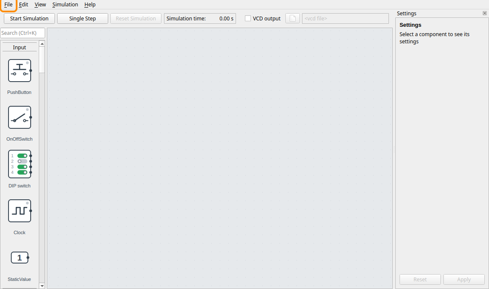

## 2. Add a Yosys component

Scroll down to the **IC / Verilog** group in the component selection, and drag **Yosys**
into the middle of the circuit area. A Yosys component gets its behavior from a Verilog
design, and DigSim asks where the design comes from:

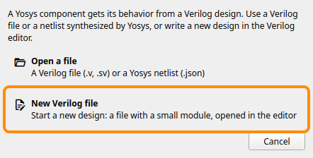

Click **New Verilog file**, and choose a folder and a file name in the file dialog, for
example `half_adder.v`. Keep the Verilog file in the same folder as the circuit that you
save in step 9, so that they stay together. On Linux, choose a folder outside `/tmp`:
Yosys runs as WebAssembly in DigSim and can't read the files there. DigSim tells you if
you choose a folder that it can't use.

The name of the file is the name of the module: `half_adder.v` gets the module
`half_adder`. DigSim never replaces a file that exists. If you choose one, it asks if you
want to use it as it is.

## 3. The settings of the component

The new component is selected, and its settings are in the settings pane, to the right of
the circuit area. Keep both boxes unchecked.

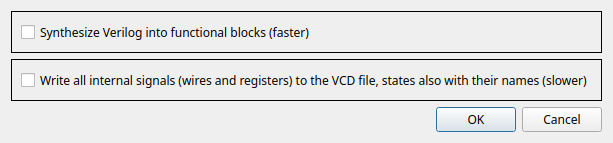

- **Synthesize Verilog into functional blocks** simulates the design faster, with blocks
  like adders and registers instead of gates. That matters for large designs.
- **Write all internal signals to the VCD file** records the wires and registers inside
  the design too, when you record a VCD file.

Both can be changed later: select the component, check the box in the settings pane, and
click **Apply**.

## 4. The new component and its Verilog

DigSim creates the file with a small module and places the component. It has the input
`a` and the output `y` of that module:

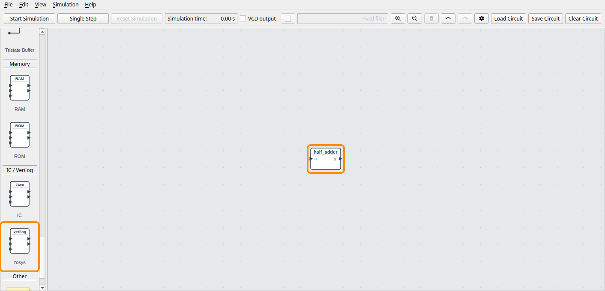

The Verilog editor opens in a window of its own, with the new file:

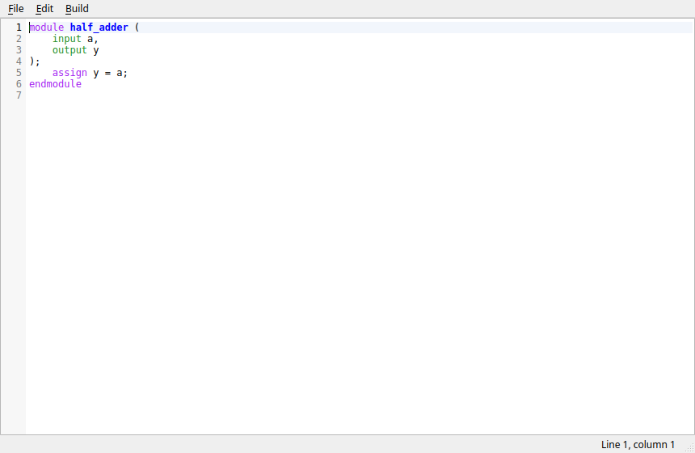

```verilog
module half_adder (
    input a,
    output y
);
    assign y = a;
endmodule
```

The module just passes `a` on to `y`. The ports are listed between the brackets after
the module name, and `assign` sets an output from the inputs.

## 5. Write the half adder

A half adder adds two bits, `a` and `b`. The result needs two bits: `sum`, the low bit,
and `carry`, the high bit.

| a | b | carry | sum | a + b |
| --- | --- | --- | --- | --- |
| 0 | 0 | 0 | 0 | 0 |
| 0 | 1 | 0 | 1 | 1 |
| 1 | 0 | 0 | 1 | 1 |
| 1 | 1 | 1 | 0 | 2 |

`sum` is 1 when exactly one of the inputs is 1: that's XOR, `^` in Verilog. `carry` is 1
when both are 1: that's AND, `&`. Replace the module in the editor with this one:

```verilog
module half_adder (
    input a,
    input b,
    output sum,
    output carry
);
    assign sum = a ^ b;
    assign carry = a & b;
endmodule
```

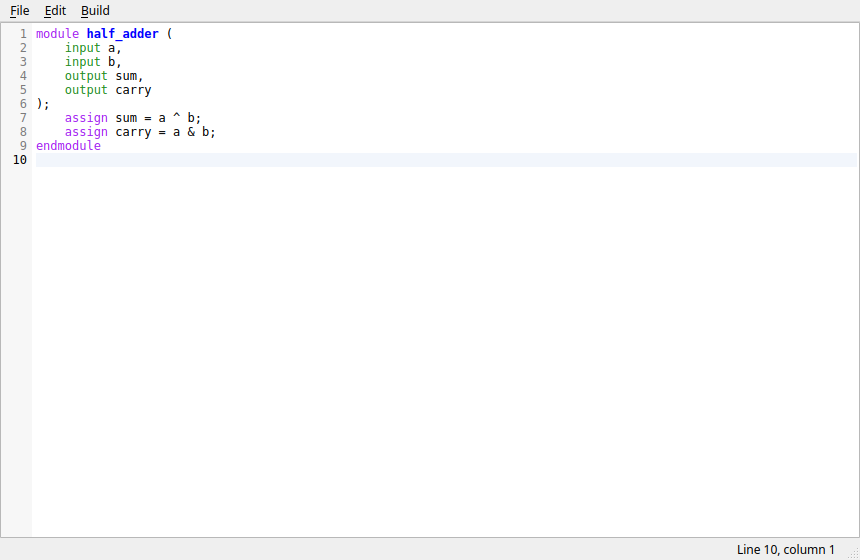

The editor indents a new line like the one before when you press **Enter**, and
**Build > Format** (**Ctrl+Shift+I**) indents the whole file. The window title gets a `*`
while the text has changes that are not saved.

## 6. Synthesize

Choose **Build > Synthesize**, or press **Ctrl+B**. The editor saves the file, and Yosys
turns the module into gates that DigSim simulates.

The ports of the module are not the ones the component has, so DigSim lists the changes
and asks first:

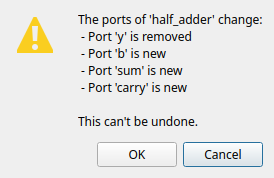

Click **OK**. New ports are added to the component, and wires to ports that are removed
are removed (there are none yet).

The build panel below the text shows each step. All of them get a ✓, apart from **Check
ports**, which gets a ⚠ for the port changes:

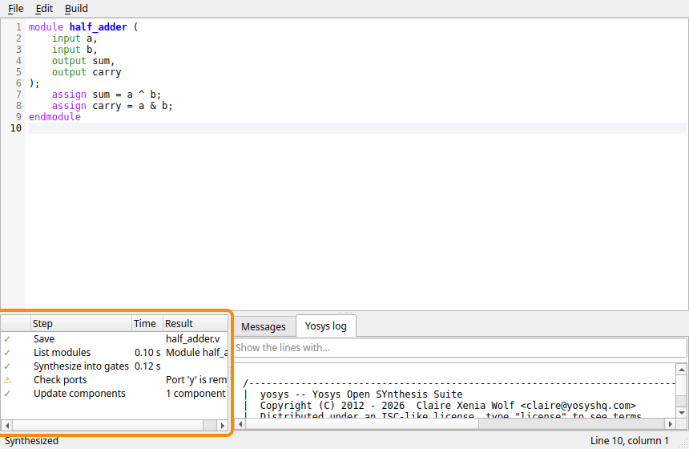

If you made a typing mistake, a step gets a ✗ instead, and the line with the error is
underlined. Fix it and press **Ctrl+B** again. The
[Verilog editor guide](verilog-tutorial.md#8-when-the-verilog-has-an-error) shows what an
error looks like.

## 7. Connect switches and LEDs

Close the editor with **File > Close** (**Ctrl+W**). The component now has the inputs `a`
and `b`, and the outputs `sum` and `carry`:

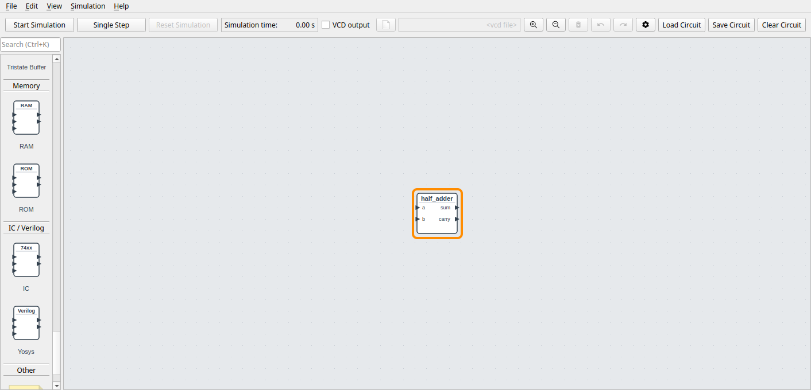

Add the parts to try it with:

- two **OnOffSwitch** from the **Input** group, to the left of the component, one above
  and one below it,
- two **LED** from the **Output** group, to the right of it, one above and one below.
  Choose **green** for the upper one, the sum, and **red** for the lower one, the carry.

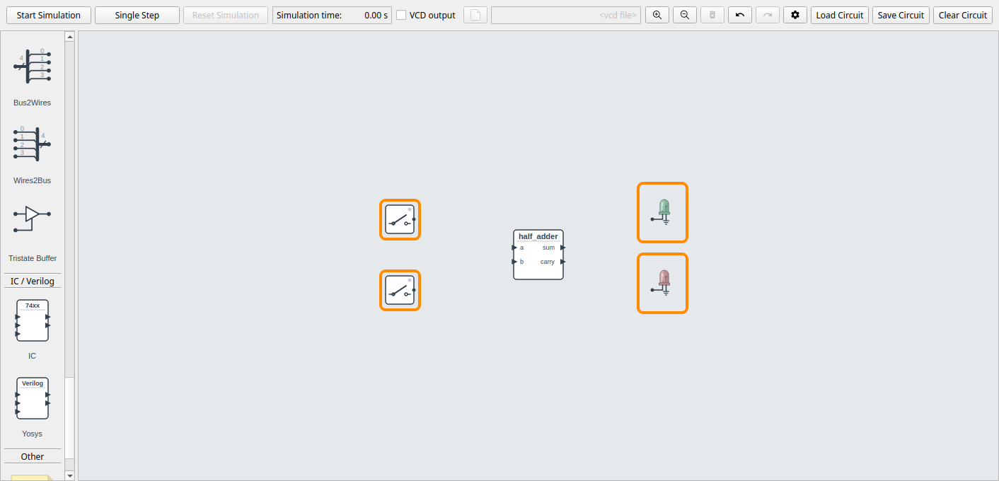

Connect them as in [Your First Circuit](first-circuit.md#6-connect-the-wires): click a
port, and then the port to connect it to.

- the upper switch to `a`, the lower switch to `b`,
- `sum` to the green LED, `carry` to the red LED.

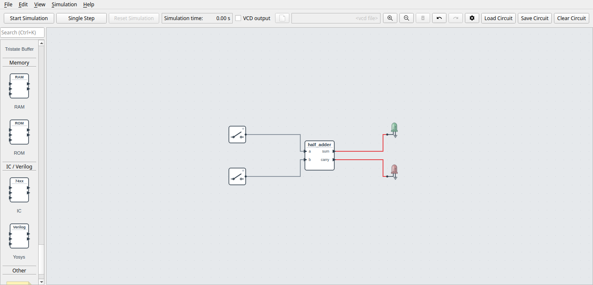

The wires from the outputs are red: the outputs are undefined until the simulation runs.

## 8. Run it

Click **Start Simulation**, and turn on the upper switch. One input is 1, so the sum is
1 and the green LED lights:

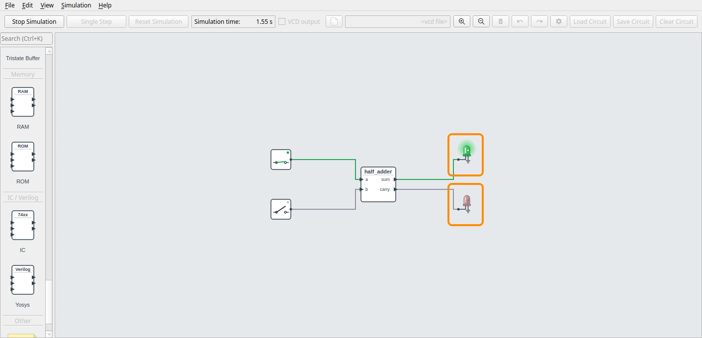

Turn on the lower switch too. 1 + 1 = 2, which is 10 in binary: the carry is 1 and the
sum is 0, so the red LED lights and the green one goes off:

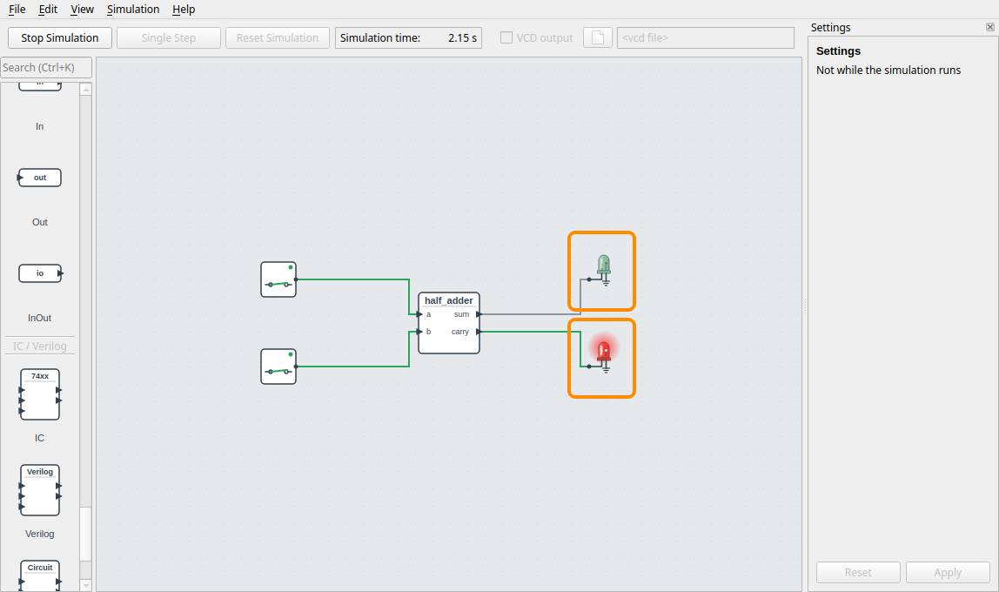

Try all four combinations and compare them with the table in step 5. Then click **Stop
Simulation**.

## 9. Save the circuit

Choose **File > Save** (**Ctrl + S**), and save the circuit in the folder of `half_adder.v`, for example
as `half_adder.circuit`. The circuit file refers to the Verilog file, by a path relative
to the circuit, and DigSim synthesizes it again when you load the circuit.

## What next

- **Change the design:** right-click the component and choose **Edit Verilog...** to open
  the editor again. [Editing a Verilog Component](verilog-tutorial.md) shows more of the
  editor, with a counter.
- **A full adder:** add a carry input, `input cin`, and add it in: `sum` is
  `a ^ b ^ cin`, and `carry` is `(a & b) | (cin & (a ^ b))`.
- **Wider designs:** ports can be buses, like `input [3:0] x`. Connect them to a DIP
  switch or a hex digit, through **Bus2Wires** and **Wires2Bus**.
- **Verilog from Python:** use the same file in a Python circuit or a pytest testbench,
  see [Verilog and Yosys](synthesis.md).
