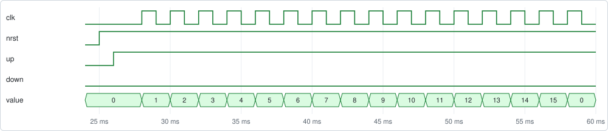
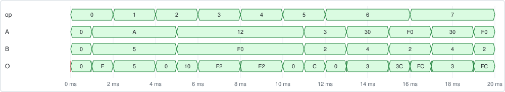

# Verilog Testbench with pytest

DigSim can be the simulator in a testbench for a Verilog design. Yosys turns the design
into a netlist, DigSim simulates it, and the test itself is plain Python, run with
[pytest](https://pytest.org/). There is no separate simulator to install, and the tests
can write a VCD file to look at in a waveform viewer.

This page walks through the testbenches in
[`examples/pytest_tb`](https://github.com/freand76/digsim/tree/main/examples/pytest_tb):
a 4-bit up/down counter and an 8-bit ALU. Install DigSim and pytest into a virtual
environment first, see [Installation](installation.md#install-into-a-virtual-environment).

## The design under test

The counter has a clock, an active low reset, and inputs to count up or down
([`up_down_counter.v`](https://github.com/freand76/digsim/blob/main/examples/pytest_tb/up_down_counter.v),
shortened):

```verilog
module up_down_counter(clk, nrst, up, down, value);

   input clk;
   input nrst;
   input up;
   input down;
   output reg [3:0] value;

   always @ (posedge clk, negedge nrst)
     begin
        if (nrst == 0)
          value <= 0;
        else if (up)
          value <= value + 1;
        else if (down)
          value <= value - 1;
     end

endmodule
```

## Loading the design

A pytest fixture creates a circuit with the design as a `YosysComponent`, the device under
test (DUT). Its ports get the names of the Verilog module's ports, so the counter has
`dut.clk`, `dut.nrst`, `dut.up`, `dut.down` and `dut.value`:

```python
import pathlib

import pytest

from digsim.circuit import Circuit
from digsim.circuit.components import YosysComponent
from digsim.synth import Synthesis
from digsim.utils import YosysNetlist


@pytest.fixture(scope="module")
def dut():
    circuit = Circuit(vcd="up_down_counter_test.vcd")
    counter = YosysComponent(circuit)
    verilog = pathlib.Path(__file__).parent / "up_down_counter.v"
    synthesis = Synthesis([str(verilog)], "up_down_counter")
    counter.create_from_netlist(YosysNetlist(**synthesis.synth_to_dict()))
    circuit.init()
    yield DutTester(circuit, counter)
```

`Synthesis` runs Yosys on the Verilog files and `synth_to_dict()` returns the netlist,
see [Verilog and Yosys](synthesis.md). Naming the top module like this also works for
designs with several modules. For a file with one module,
`YosysComponent(circuit, path="up_down_counter.v")` synthesizes it in one step.

With `scope="module"`, the design is synthesized once for all tests in the file, and the
tests share the DUT. Each test therefore starts with a reset. Synthesis of a small design
takes a fraction of a second, so a fresh DUT for each test, with the default function
scope, works too.

## Driving the inputs

The DUT's inputs aren't driven by other components, so the test sets them directly with
`.value`, and reads the outputs the same way. After a change, the test runs the circuit
for a while, so that the change goes through the gates of the netlist. A helper class
keeps the tests short:

```python
class DutTester:
    """A helper class to test the up/down counter DUT (Device Under Test)"""

    def __init__(self, circuit, dut):
        self._circuit = circuit
        self._dut = dut
        # Initialize DUT inputs
        self._dut.clk.value = 0
        self._dut.nrst.value = 0
        self._dut.up.value = 0
        self._dut.down.value = 0

    def reset(self):
        """Reset the DUT"""
        self._dut.nrst.value = 0
        self._circuit.run(ms=1)
        self._dut.nrst.value = 1
        self._circuit.run(ms=1)

    def clock(self):
        """Generate a clock cycle"""
        self._dut.clk.value = 1
        self._circuit.run(ms=1)
        self._dut.clk.value = 0
        self._circuit.run(ms=1)

    def up(self, up):
        """Set the 'up' signal"""
        self._dut.up.value = 1 if up else 0
        self._circuit.run(ms=1)

    def value(self):
        """Get the counter value"""
        return self._dut.value.value
```

A few things to know:

- **Give every input a value** before the first clock. An input that was never set is
  undefined, `"X"`, and so are the outputs that depend on it. Until the reset, the counter
  value reads `"X"` too.
- **Buses are integers.** A 4-bit output reads as a number from 0 to 15, and a bus input
  takes a number.
- **Run long enough.** The gates of a netlist have delays of a few nanoseconds, so a design
  this size settles well within 1 µs. The examples run 1 ms per step, which is more than
  enough and makes the waveforms easy to read.

## Writing the tests

Each test resets the DUT, sets the inputs, clocks it and checks the outputs with
`assert`:

```python
def test_count_up(dut):
    """Test up counting function"""
    dut.reset()
    assert dut.value() == 0
    dut.up(True)
    dut.down(False)

    for idx in range(1, 16):
        dut.clock()
        assert dut.value() == idx

    # Assert wrap around from 15 to 0
    dut.clock()
    assert dut.value() == 0
```

In the waveforms of this test, the reset is followed by `up`, and each clock cycle counts
one up, from 0 to 15 and around to 0:



The other tests check that the counter doesn't count with neither input set, counts down
and wraps from 0 to 15, counts up when both inputs are set, and resets after counting.
The whole file is
[`test_up_down_counter_testbench.py`](https://github.com/freand76/digsim/blob/main/examples/pytest_tb/test_up_down_counter_testbench.py).

## A design without a clock

The ALU testbench tests a combinational design: an 8-bit ALU with an operation code and
two operands. It has no clock or reset: the test sets the inputs, runs the circuit and
reads the result
([`test_alu_testbench.py`](https://github.com/freand76/digsim/blob/main/examples/pytest_tb/test_alu_testbench.py)):

```python
ALU_OP_ADD = 0
ALU_OP_AND = 2


class DutTester:
    """A helper class to test the ALU DUT (Device Under Test)"""

    def __init__(self, circuit, dut):
        self._circuit = circuit
        self._dut = dut
        # Initialize DUT inputs
        self._dut.A.value = 0
        self._dut.B.value = 0
        self._dut.op.value = 0

    def op(self, op):
        """Set the ALU operation"""
        self._dut.op.value = op
        self._circuit.run(ms=1)

    def operands(self, A, B):
        """Set the ALU operands"""
        self._dut.A.value = A
        self._dut.B.value = B
        self._circuit.run(ms=1)

    def result(self):
        """Get the ALU result"""
        return self._dut.O.value

    def alu_op(self, op, A, B):
        """Helper function to execute a full ALU operation"""
        self.op(op)
        self.operands(A, B)
        return self.result()


def test_add(dut):
    """Test the ADD operation"""
    assert dut.alu_op(ALU_OP_ADD, 10, 5) == 15


def test_and(dut):
    """Test the AND operation"""
    assert dut.alu_op(ALU_OP_AND, 0x12, 0xF0) == 0x10
```

The waveforms of the ALU testbench, in hexadecimal. The helper sets the operation first
and the operands 1 ms later, so each new operation first works on the operands of the one
before, which gives the short results in between:



For many cases of the same check, `@pytest.mark.parametrize` gives each case its own test.

## Running the tests

From the repository root:

```sh
uv run --with pytest pytest -v examples/pytest_tb
```

```text
examples/pytest_tb/test_alu_testbench.py::test_add PASSED
examples/pytest_tb/test_alu_testbench.py::test_sub PASSED
...
examples/pytest_tb/test_up_down_counter_testbench.py::test_count_up PASSED
examples/pytest_tb/test_up_down_counter_testbench.py::test_count_down PASSED
...
```

A failing `assert` shows the expected and the actual value, like any pytest test.

## Waveforms

`Circuit(vcd="up_down_counter_test.vcd")` writes every signal of the design to a VCD file
while the tests run. The tests share the circuit, so the file holds all of them, one after
the other. Open it in [GTKWave](https://gtkwave.sourceforge.net/) or a similar viewer to
see what happened, for example when a test fails:


The waveforms show all the counter tests in order: no counting, counting up to 15 and
wrapping to 0, counting down, and resets.
