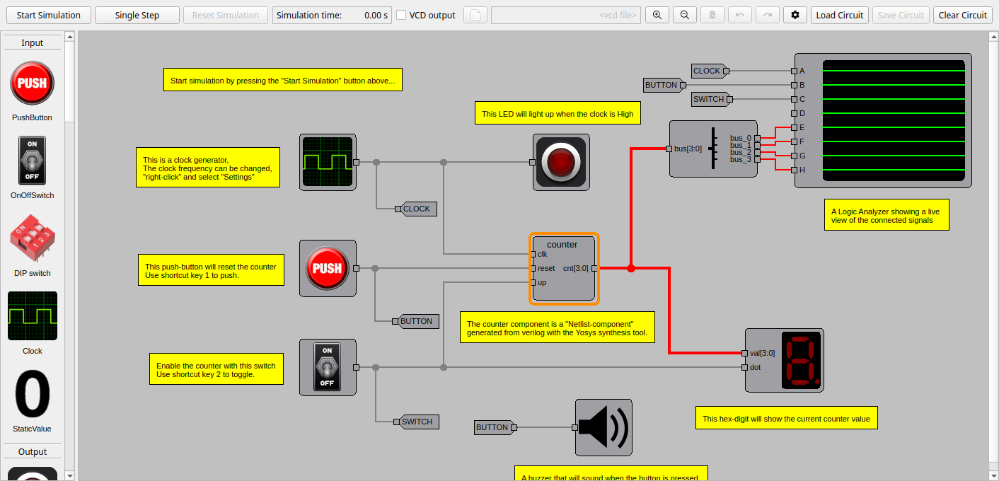
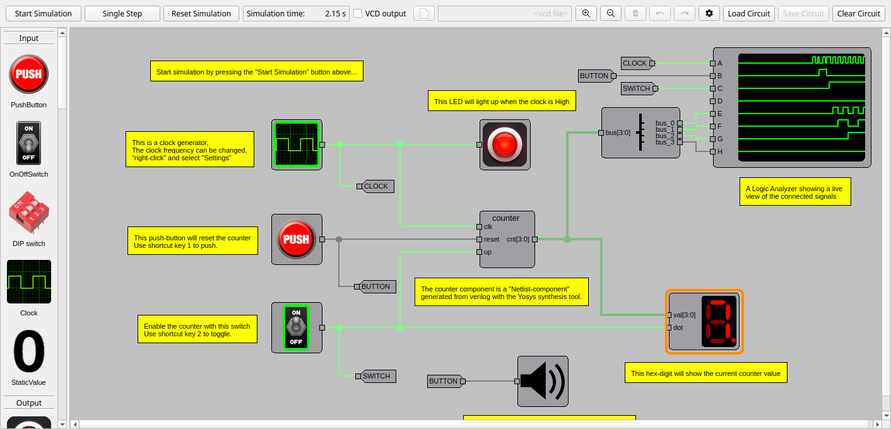
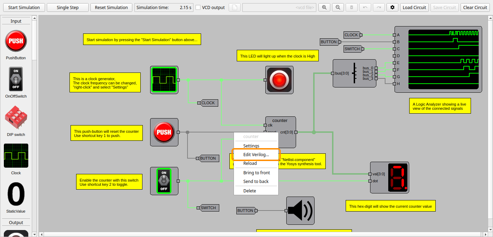
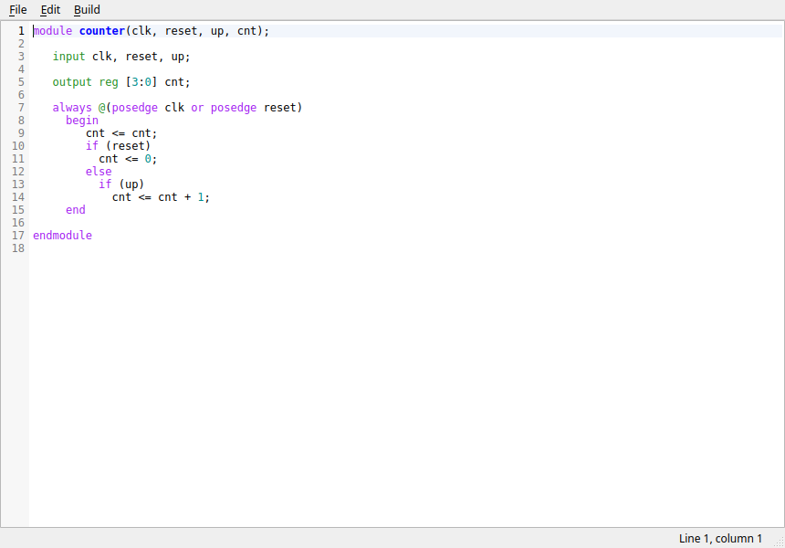
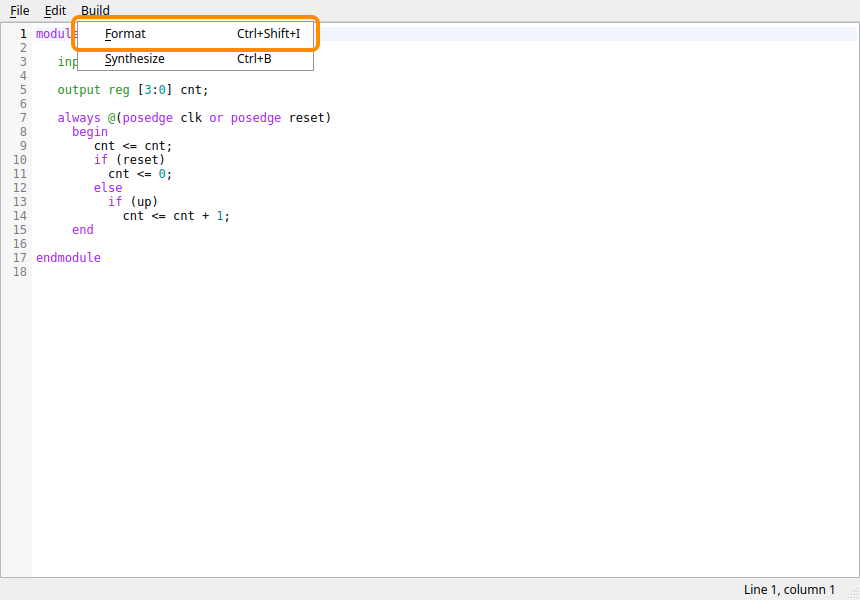
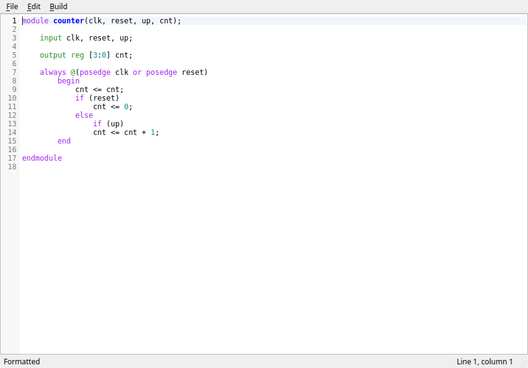
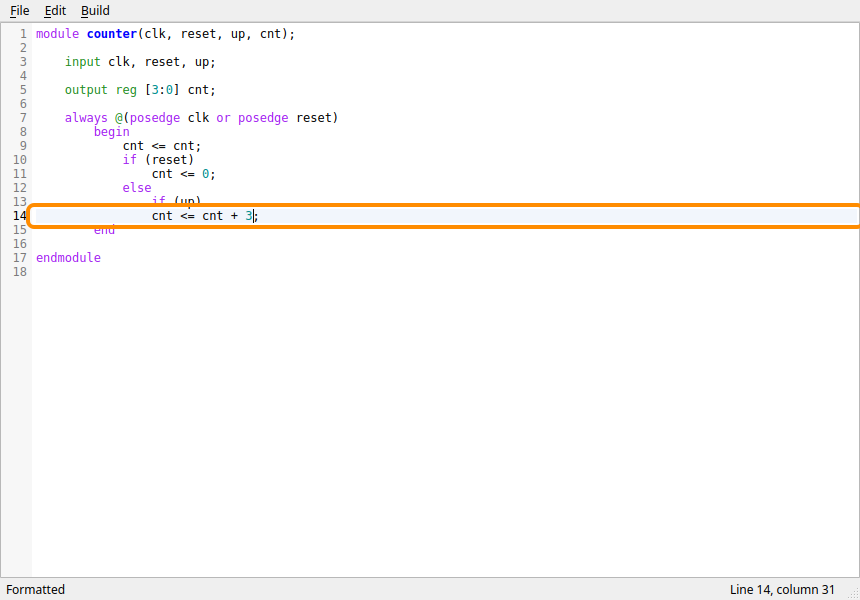
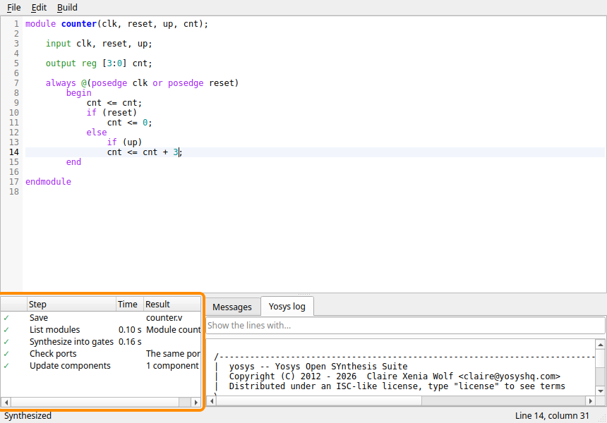
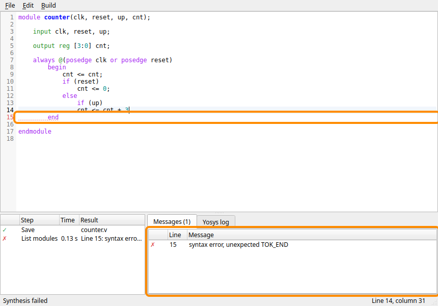
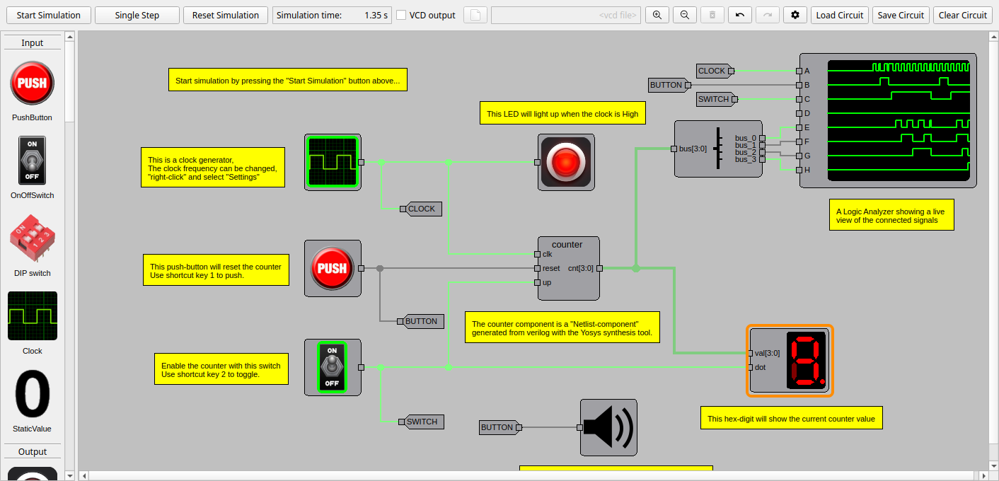

# Editing a Verilog Component

This guide walks you through changing the Verilog of a component without leaving DigSim.
You start from an example circuit with a 4-bit counter written in Verilog, make it count
by three instead of by one, and run it again. It takes about ten minutes, and you will
learn to:

- open the Verilog of a component in the editor,
- format the Verilog,
- change it and synthesize it, so that the component runs the new version,
- find and fix an error that Yosys reports,
- run the circuit with the changed component.

You need DigSim installed (see [Installation](installation.md)) and a clone of the
repository, which has the example circuits, see
[Run from source](installation.md#run-from-source). If you haven't used DigSim before,
start with [Your First Circuit](first-circuit.md).

!!! note
    This guide changes `examples/yosys_counter/counter.v` in your clone. Step 10 shows
    how to get the original back.

## 1. Load the counter circuit

Open a terminal in the root folder of your clone and start DigSim with the example
circuit:

```sh
uv run -m digsim.app --load example_circuits/counter_yosys_verilog.circuit
```

You can also start DigSim as usual, click **Load Circuit** in the control area, and open
`example_circuits/counter_yosys_verilog.circuit`.



The circuit has these parts:

- **counter** (framed): a Yosys component, made from the Verilog file
  `examples/yosys_counter/counter.v`. It has the inputs `clk`, `reset` and `up`, and the
  4-bit output `cnt`.
- A **clock** on the left drives `clk`, five times a second. The LED next to it lights
  while the clock is high.
- A **push button** drives `reset`. Press it with the mouse, or with the **1** key.
- A **switch** drives `up`, which enables the counter. Toggle it with the mouse, or with
  the **2** key. It also drives the dot of the hex digit.
- A **hex digit** shows `cnt`, and a **logic analyzer** shows all the signals over time.

## 2. Run the counter as it is

Before changing anything, see what the counter does now:

1. Click **Start Simulation**.
2. Click the **push button** (or press **1**) to reset the counter to 0.
3. Click the **switch** (or press **2**) to turn it on.

The hex digit counts 0, 1, 2, ... up to F, and starts over at 0. One step for each clock
cycle.



Click **Stop Simulation** when you have seen enough.

## 3. Open the Verilog editor

Right-click the **counter** component and choose **Edit Verilog...**.



The menu item is there for every Yosys component made from a Verilog file (`.v` or
`.sv`). A component made from a Yosys netlist (`.json`) only has **Reload**.

## 4. A look at the editor

The editor opens in a window of its own, with `counter.v`:



- The **line numbers** are on the left. The line with the cursor is highlighted, and the
  status bar at the bottom shows the line and column.
- The Verilog is **colored** like in the Emacs `verilog-mode`: keywords like `always` and
  `begin` in purple, declarations like `input` and `reg` in green, the module name in
  bold blue, numbers in cyan, and comments in red.
- When the cursor is next to a bracket, the bracket and its match are highlighted.
- The menus are **File** (save, revert to saved, close), **Edit** (undo, cut, copy,
  paste, find and replace, go to line, comment out, indent) and **Build** (format,
  synthesize).

The editor edits the file, not the component. If two components are made from the same
file, they share one editor, and **Synthesize** updates both.

The interesting line is line 14:

```verilog
cnt <= cnt + 1;
```

On every rising edge of `clk`, when `reset` is low and `up` is high, the counter adds 1.

## 5. Format the Verilog

`counter.v` is indented with three spaces, and the statements under `if` and `else` with
two. Make the indentation even before you change anything: choose **Build > Format**, or
press **Ctrl+Shift+I**.



Each line is now indented four spaces for each block (`module`, `begin`) it is in, and a
statement under an `if` or an `else` one step more:



Formatting only changes whitespace: the indentation, spaces at the end of lines, and
empty lines (at most one in a row). The code itself is never changed. If the formatter
can't keep it the same, it leaves the text as it is and says so in the status bar.

!!! tip
    **Ctrl+Z** undoes the formatting in one step. You can also format files from the
    command line, see [Formatting Verilog](synthesis.md#formatting-verilog).

The window title now has a `*`: the text has changes that are not saved.

## 6. Make it count by three

Change the `1` on line 14 into a `3`:

1. Press **Ctrl+G**, type **14** and press **Enter** to go to line 14. You can also just
   click the line.
2. Select the `1` (double-click it), and type `3`.



Some keys that help when you write more Verilog:

| Keys | Action |
| --- | --- |
| Enter | A new line with the indentation of the line before, one step more after `begin` or an open bracket |
| Tab / Shift+Tab | Indent or unindent the selected lines (Tab inserts spaces) |
| Ctrl+/ | Comment out the selected lines, or remove their comments |
| Ctrl+F / Ctrl+H | Find, find and replace |
| Ctrl+S | Save |

## 7. Synthesize

Choose **Build > Synthesize**, or press **Ctrl+B**. The editor saves the file, and Yosys
synthesizes it in the background, so DigSim keeps responding while it works. The build
panel opens below the text, and shows each step:



| Step | What it does |
| --- | --- |
| Save | Saves `counter.v`, Yosys reads the file from disk |
| List modules | Reads the Verilog and checks that the file has one module, as a Yosys component needs |
| Synthesize into gates | Turns the module into a netlist of gates and flip-flops. A component with **Synthesize Verilog into functional blocks** checked gets a step "Synthesize into functional blocks" instead |
| Check ports | Compares the ports of the new module with the component's. Here they are the same |
| Update components | Builds the components of the file from the new netlist |

A ✓ is a step that went well, a ⚠ one with warnings, and a ✗ one that failed. The
**Time** column shows how long each step took, and **Result** what came out of it.

The tabs to the right show the **Messages** of Yosys (errors and warnings) and the whole
**Yosys log**. The field above the log shows only the lines with the text you type.

When the components are updated, the simulation starts over at time 0, as after **Reset
Simulation**. If it was running, it stops.

## 8. When the Verilog has an error

Mistakes happen, so here is what one looks like. Delete the `;` at the end of line 14,
and press **Ctrl+B** again.



- The **List modules** step failed (✗), and its result says what Yosys found.
- The **Messages** tab lists the error with its line. Double-click it to move the cursor
  there.
- The line is **underlined** in the text, and its line number is red. Warnings are
  orange. The marks go away when you change the text.

Yosys reports line 15, not 14: it only notices that the `;` is missing when it finds
`end` where the end of the statement should be. Look at the line before as well.

The counter component is not changed when synthesis fails. It keeps the Verilog it was
built from, and the circuit still works.

Type the `;` back at the end of line 14, and press **Ctrl+B** again. All steps get a ✓.

## 9. Run the new counter

Close the editor (**File > Close**, or **Ctrl+W**). It doesn't ask anything: the file is
saved, and the counter is built from it.

Back in the main window, run the counter as in step 2: **Start Simulation**, reset with
the push button (**1**), and enable with the switch (**2**). Now the hex digit counts by
three: 0, 3, 6, 9, C, F, 2, 5, 8, ... The counter has 4 bits, so after F (15) it goes on
at 18 - 16 = 2.



!!! tip
    If you close the editor after saving, but without synthesizing, it offers to
    synthesize the file first. **Yes** synthesizes it and closes the editor when the
    counter is updated. **No** closes the editor and leaves the counter as it was.

## 10. Get the original back

The guide changed `examples/yosys_counter/counter.v`. To get the original back, run this
in the root folder of your clone:

```sh
git checkout examples/yosys_counter/counter.v
```

The circuit file itself is not changed, unless you saved it with **Save Circuit**.

## What next

- **Change the ports:** add an output to the module, like `output carry`, and synthesize.
  DigSim lists the port changes and asks first. New ports are added unconnected, and the
  wires to ports that are removed, or get another width, are removed. See
  [Yosys component](gui.md#yosys-component).
- **A new design:** add a Yosys component, and choose **New Verilog file**. DigSim
  creates the file with a small module and opens it in the editor.
- **Faster simulation:** right-click the counter, choose **Settings**, and check
  **Synthesize Verilog into functional blocks**. The editor then synthesizes the file
  into functional blocks for it, see
  [Gates or functional blocks](synthesis.md#gates-or-functional-blocks).
- **All the keys and menus of the editor:** see
  [The Verilog editor](gui.md#the-verilog-editor).
